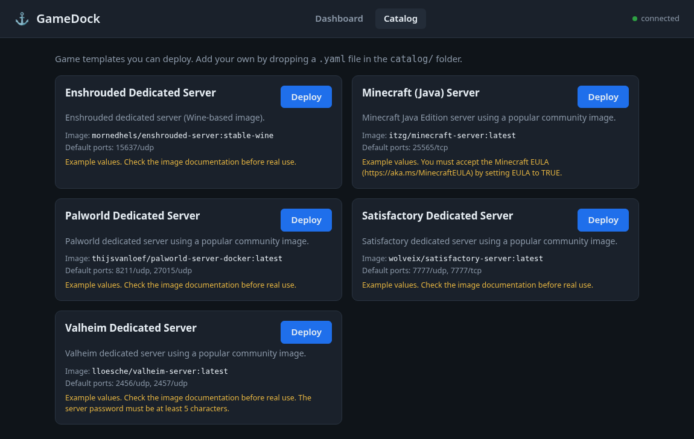
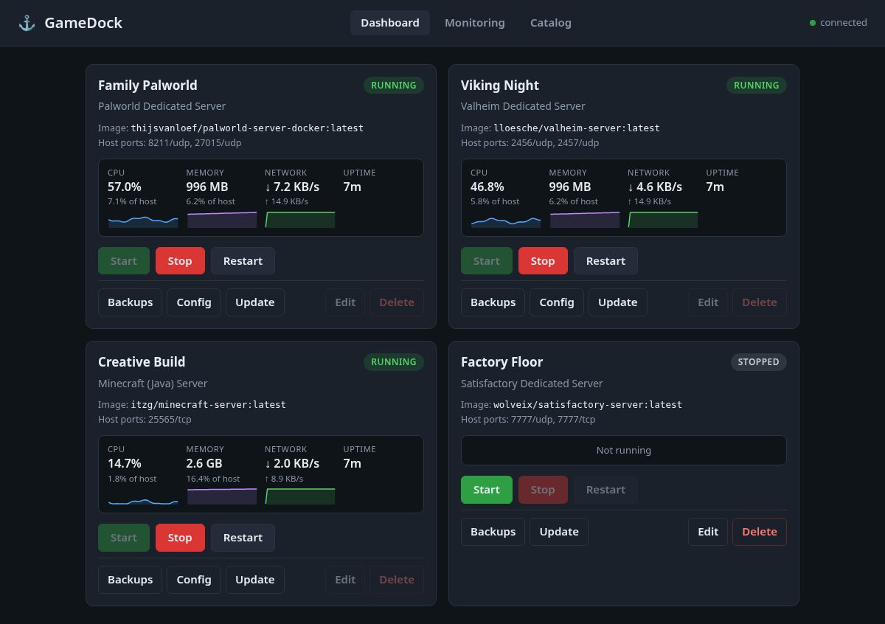
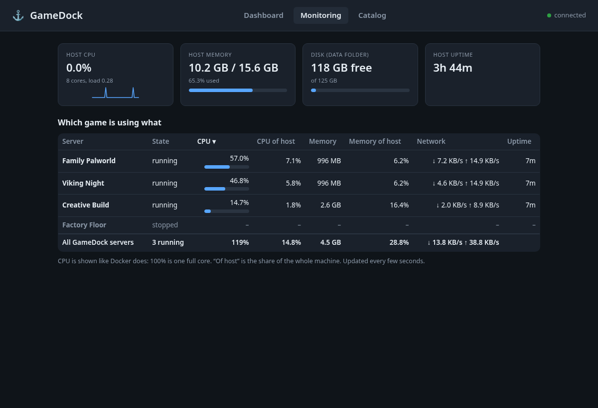
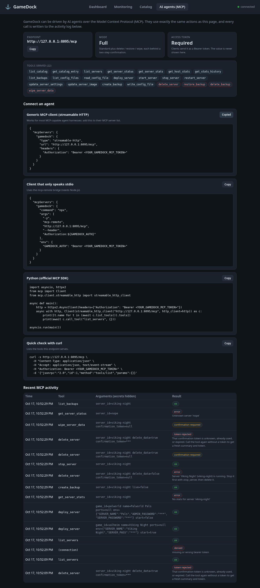
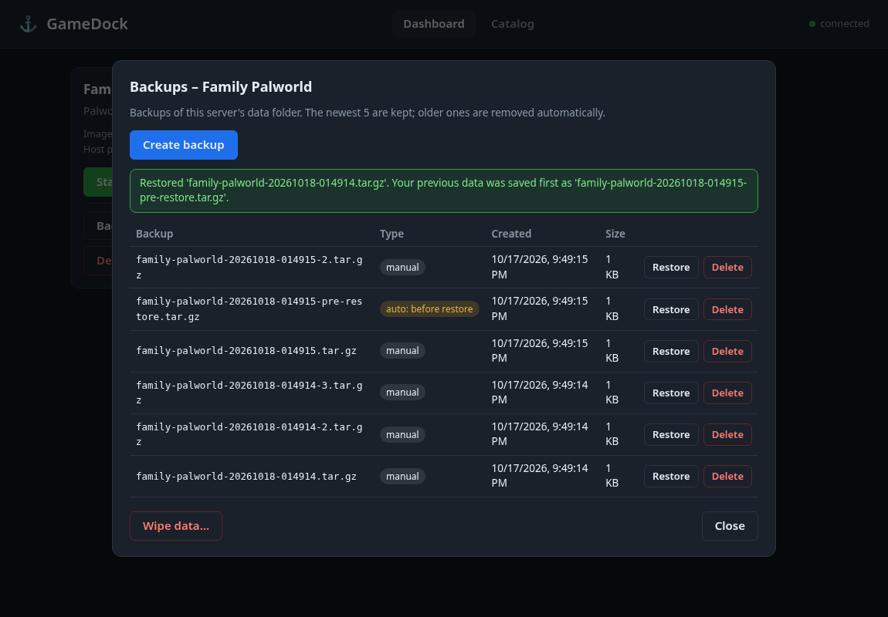
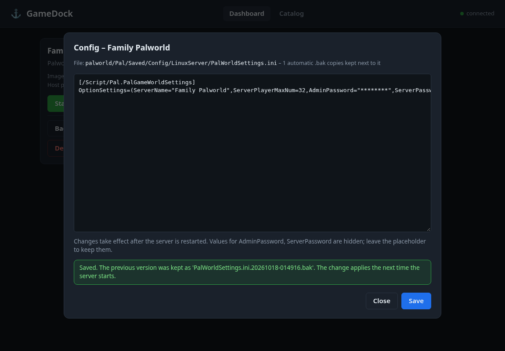

# GameDock

A small, self-hosted game hosting manager for home use. Each game server runs in its own Docker container (SteamCMD and Wine based images work well). GameDock gives you a simple web dashboard to see and control them, and has a built-in MCP endpoint so AI agents can manage servers through the same service layer.

GameDock is not tied to any particular machine or game: games are described by small YAML files in `catalog/`.








**Status:** step 5 of the plan. Browse a catalog of game templates, deploy servers (several of the same game can coexist on different ports), edit their settings, start / stop / restart, back up and restore their data, update their images, edit their config files, watch CPU / memory / network per game, delete them safely, and let AI agents do the same through MCP (`/mcp`).

## Concepts

- **Catalog entry**: a game template in `catalog/*.yaml` (image, default ports, volumes, the settings you can fill in).
- **Server**: a deployed instance made from a catalog entry. It has its own name, host ports and settings, and is stored in `data/instances.json` (created with mode 0600 because it can contain passwords; `data/` is git-ignored). A server keeps a snapshot of its template, so later catalog edits never break it.

## Run it

Requires Python 3.10+ and, for real use, Docker (the `docker` command must work for the user running GameDock).

```bash
python3 -m venv .venv
. .venv/bin/activate
pip install -e .            # or: pip install -r requirements.txt
cp .env.example .env        # optional; edit as needed
python -m gamedock          # then open http://127.0.0.1:8080
```

Try it without Docker using the pretend in-memory engine:

```bash
GAMEDOCK_BACKEND=fake python -m gamedock
```

### Settings (environment variables or `.env`)

| Variable | Default | Meaning |
|---|---|---|
| `GAMEDOCK_HOST` | `127.0.0.1` | Listen address. Local only by default. Only set `0.0.0.0` if you accept that anyone who can reach the port can control your servers (no login yet). |
| `GAMEDOCK_PORT` | `8080` | Web port |
| `GAMEDOCK_CATALOG_DIR` | `./catalog` | Folder of game definition files |
| `GAMEDOCK_DATA_DIR` | `./data` | Server data and `instances.json`. Relative volume paths go under `<data>/<server id>/` |
| `GAMEDOCK_BACKEND` | `docker` | `docker` or `fake` |
| `GAMEDOCK_BACKUP_RETENTION` | `10` | Backups kept per server; the oldest are removed after each new backup |
| `GAMEDOCK_STATS_ENABLED` | `true` | Run the background sampler that feeds the sparklines |
| `GAMEDOCK_STATS_INTERVAL` | `10` | Seconds between samples (2 to 300) |
| `GAMEDOCK_STATS_HISTORY_SECONDS` | `3600` | History kept in memory (60 to 86400); at most 2000 points per server |
| `GAMEDOCK_METRICS_ENABLED` | `false` | Serve Prometheus text at `/metrics` |
| `GAMEDOCK_METRICS_ALLOW_REMOTE` | `false` | Let non-local clients read `/metrics` |
| `GAMEDOCK_MCP_MODE` | `standard` | `off`, `read_only`, `standard` or `full` (see [AI agents](#ai-agents-mcp)). Forced to `off` when `GAMEDOCK_HOST` is not localhost and no token is set |
| `GAMEDOCK_MCP_TOKEN` | *(empty)* | Optional bearer token clients must send to `/mcp` |
| `GAMEDOCK_MCP_ALLOWED_HOSTS` | *(empty)* | Extra `Host` values `/mcp` accepts, comma separated (`gamedock.lan:8080`) |
| `GAMEDOCK_MCP_ALLOWED_ORIGINS` | *(empty)* | Extra `Origin` values `/mcp` accepts (browser-based MCP clients), comma separated |

## Using it

1. Open **Catalog**, press **Deploy** on a game.
2. Pick a name, check the host ports (prefilled with the defaults; a port already used by another server is refused) and fill in the settings. Password-type settings use password inputs and are never shown again, logged, or returned by the API.
3. Tick **Start after deploy** if you want it to run right away. Deploy creates the container either way.
4. On the **Dashboard**: Start / Stop / Restart, **Edit** (name, ports, settings; server must be stopped, its container is recreated; leave a password blank to keep the stored one) and **Delete**.

## Backups

Every server has a **Backups** panel (dashboard card, "Backups" button).

- **Create backup** writes `<data>/backups/<server id>/<server id>-YYYYMMDD-HHMMSS.tar.gz` (UTC time in the name) containing the server's data folder (`<data>/<server id>/`). No sudo is used.
- **Consistent by default:** if the server is running, GameDock stops it, takes the backup and starts it again, and tells you so. Tick "Back up without stopping (live)" to skip that; the result then warns the files may be inconsistent.
- **Retention:** only the newest N backups per server are kept (default 10, `GAMEDOCK_BACKUP_RETENTION`), applied after every new backup.
- **Restore** needs a stopped server and confirmation. Before replacing anything GameDock takes an automatic safety backup (`...-pre-restore.tar.gz`); if that fails the restore is cancelled. The archive is checked first (no `..`, absolute paths, or links pointing outside) and unpacked beside the data folder before being swapped in, so a damaged backup never touches your current data.
- **Delete backup** needs confirmation.
- **Wipe data** (empties the data folder, keeps the server) needs confirmation and a stopped server, and takes a `...-pre-wipe` backup first.
- **Delete server with its data** needs two confirmations (`confirm` and `confirm_delete_data`), a stopped server, and first saves a backup outside the data folder at `<data>/backups/_deleted/<id>-<time>-pre-delete.tar.gz`. If that backup fails nothing is deleted.
- **Permissions:** GameDock runs as its own user. If a game container wrote files as another user (often root) that GameDock cannot read, the backup stops with a clear message (and the `chown` command that would fix it), nothing partial is left, and any operation that needed the backup first (restore, wipe, delete with data, update) is cancelled.
- Only the server's own data folder is saved. Volumes with an **absolute** host path in a catalog entry live outside it and are not backed up. Backups are taken and restored as the GameDock user, so file ownership becomes that user's.

## Monitoring

Built in, light, and with no database or extra services (it does not need Prometheus).

- **Dashboard cards** show live CPU, memory, network rate and uptime for each running server, with small sparklines of the last ~10 minutes.
- **Monitoring page** shows host totals (CPU, memory, load, free disk on the volume holding the data folder, uptime) and a table ranking your servers by CPU or memory (click a column header), with each server's share of the whole host and a total row.
- CPU is shown the way Docker does: 100% is one full core. "Of host" divides by the number of cores.
- **How it stays cheap:** a background thread samples every `GAMEDOCK_STATS_INTERVAL` seconds (default 10). Each sample makes at most two Docker calls for *all* servers together (`docker inspect` for state and start times, and `docker stats --no-stream` for the running ones), never one per server. If nothing is running it makes just the one small inspect call, at half the normal rate, and records nothing; with no servers deployed it makes no Docker call. Host numbers come from `/proc` and `shutil`.
- **History** lives in fixed-size in-memory ring buffers (about one hour at the default settings, hard-capped at 2000 points per server), so memory use is bounded and it resets when GameDock restarts. Stopping or deleting a server drops its history.
- Network and block I/O are cumulative counters from Docker; the UI shows network as a rate computed between samples.

### Optional Prometheus / Grafana

Off by default. To let your own Prometheus scrape GameDock, set `GAMEDOCK_METRICS_ENABLED=true`. GameDock then serves Prometheus text format at `/metrics`, built from the sampler's latest reading (so a scrape never triggers extra Docker calls). It answers only clients on the same machine unless you also set `GAMEDOCK_METRICS_ALLOW_REMOTE=true` (and make GameDock reachable with `GAMEDOCK_HOST`; there is no login, so only do that on a network you trust).

Prometheus on the same host:

```yaml
scrape_configs:
  - job_name: gamedock
    scrape_interval: 15s
    static_configs:
      - targets: ["127.0.0.1:8080"]
```

If Prometheus runs in a Docker container it does not appear as `127.0.0.1` to GameDock, so you need `GAMEDOCK_METRICS_ALLOW_REMOTE=true` and a `GAMEDOCK_HOST` it can reach.

Metrics (labels `server` = server id, `game` = catalog id):

| Metric | Type | Meaning |
|---|---|---|
| `gamedock_server_running` | gauge | 1 if the container runs |
| `gamedock_server_cpu_percent` | gauge | 100 = one core |
| `gamedock_server_memory_bytes`, `gamedock_server_memory_limit_bytes` | gauge | memory in use / limit |
| `gamedock_server_network_receive_bytes_total`, `..._transmit_bytes_total` | counter | since container start |
| `gamedock_server_block_read_bytes_total`, `..._block_write_bytes_total` | counter | disk I/O since container start |
| `gamedock_server_uptime_seconds` | gauge | running servers only |
| `gamedock_servers`, `gamedock_build_info{version}` | gauge | count of servers, version |
| `gamedock_host_cpu_percent`, `gamedock_host_cpu_count`, `gamedock_host_load1` | gauge | host CPU |
| `gamedock_host_memory_total_bytes`, `gamedock_host_memory_used_bytes` | gauge | host memory |
| `gamedock_host_disk_total_bytes`, `gamedock_host_disk_free_bytes` | gauge | volume with the data folder |

Example Grafana queries: `gamedock_server_cpu_percent` (one line per game), `sum(gamedock_server_memory_bytes)`, `rate(gamedock_server_network_transmit_bytes_total[5m])`.

## Updating a server

**Update** (dashboard card) pulls the newest version of the server's image and recreates the container, keeping data and settings. GameDock pulls first; if the image is already the newest, nothing else happens. Otherwise it stops the server if running (with a 60 s grace period), takes an automatic `...-pre-update` backup (if that fails the update is cancelled and the server is restarted), recreates the container and starts it again if it had been running. The image id before and after is shown. A catalog entry can set `update_method: none` for games that update themselves inside the container (the Update button then disappears).

## Editing config files

A catalog entry can declare config files; each server then gets a **Config** button with a text editor.

- Only declared files can be opened, and the path must stay inside the server's data folder: `..`, absolute paths, and symlinks (to outside or inside) are refused.
- Files are limited to 256 KB of UTF-8 text. JSON files are validated before saving.
- Every save first copies the old file to `<name>.<timestamp>.bak` beside it (the newest 10 are kept) and then replaces it atomically.
- Saving is refused while the server runs unless the catalog marks the file `hot_edit: true`. Most games need a restart to pick up changes; the editor says so.
- `sensitive_keys` values (passwords) are shown as `********`. Leave the placeholder to keep the real value; type over it to change it. Works for `key=value`, `key: value`, JSON and inline `Key="value"` styles.

## Adding a game

Drop a `.yaml` (or `.json`) file in `catalog/`; it appears in the Catalog page without a restart.

```yaml
id: my-game              # lowercase letters, digits, - and _
name: My Game Server
image: some/image:tag
description: One line shown on the card.
notes: Shown in amber on the card (use it for warnings).
ports:                   # defaults; each server can choose its own host ports
  - { protocol: udp, host: 27015, container: 27015 }
volumes:
  - { host: ./saves, container: /saves }   # relative = under <data>/<server id>/
env:                     # fixed values, not editable in the deploy form
  SOME_FLAG: "1"
update_method: pull_recreate   # default; or 'none' if the game updates itself
config_files:            # files users may edit (relative to the server's data folder)
  - path: saves/settings.ini
    label: Settings
    format: ini          # ini | json | yaml | text (json is validated)
    sensitive_keys: [AdminPassword]
    hot_edit: false      # true = safe to edit while running
fields:                  # settings shown in the deploy/edit form
  - { name: SERVER_NAME, label: Server name, default: "My Server", required: true }
  - { name: SERVER_PASSWORD, label: Password, secret: true }   # secret = password input
```

Never put real passwords in catalog files (they are committed to git); users type them into the deploy form.

A server keeps a snapshot of its template from the time it was deployed, so config files and update settings added to a catalog entry later only apply to servers deployed afterwards.

**The bundled entries (Enshrouded, Palworld, Valheim, Minecraft Java, Satisfactory) are examples.** Their images, ports and variables are written from general knowledge of popular community images and have not been tested here. Check each against the image's own documentation before real use.

## AI agents (MCP)

GameDock serves a [Model Context Protocol](https://modelcontextprotocol.io) endpoint at **`/mcp`** on the same port as the web page (no extra process). It uses the official Python `mcp` SDK (2.x), Streamable HTTP, stateless. Every tool calls the same `GameDockService` methods as the web page, so the two can never disagree. The **AI agents (MCP)** page in the web UI shows the endpoint URL, the current mode, whether a token is set, copy-paste connection snippets and the recent activity.

### Modes (`GAMEDOCK_MCP_MODE`)

| Mode | Tools served |
|---|---|
| `off` | none (`/mcp` answers 404 with an explanation) |
| `read_only` | `list_catalog`, `get_catalog_entry`, `list_servers`, `get_server_status`, `get_server_stats`, `get_host_stats`, `get_stats_history`, `list_backups`, `list_config_files`, `read_config_file` |
| `standard` (default) | read-only tools plus `deploy_server`, `start_server`, `stop_server`, `restart_server`, `update_server_settings`, `update_server_image`, `create_backup`, `write_config_file` |
| `full` | standard plus the destructive tools `delete_server`, `restore_backup`, `delete_backup`, `wipe_server_data` |

Tools outside the mode are not listed at all and cannot be called. If `GAMEDOCK_HOST` is not localhost and `GAMEDOCK_MCP_TOKEN` is empty, the mode is forced to `off` (a warning is logged and the web page explains why).

### Destructive tools need two steps

`delete_server`, `restore_backup`, `delete_backup` and `wipe_server_data` never act on the first call. The first call changes nothing and returns a plain-language **summary** of exactly what would happen (including the automatic backup that is taken first) plus a **confirmation token**. Only a second call with the same arguments plus `confirmation_token` does it. Tokens last about 2 minutes, work once, are kept in memory only, and are tied to the exact action and arguments (change `delete_data` and the token is refused). A running server must be stopped first; that is reported before any token is issued. The built-in guide tells agents to show the summary to a human before confirming.

### Security

- Optional bearer token: set `GAMEDOCK_MCP_TOKEN` (for example `python -c "import secrets; print(secrets.token_urlsafe(32))"`); clients send `Authorization: Bearer <token>`. The comparison is constant-time and the token is never returned, shown or logged.
- `Host` header check against DNS rebinding: only localhost names (any port) and the bind address are accepted, plus `GAMEDOCK_MCP_ALLOWED_HOSTS`. When bound to `0.0.0.0` with nothing configured, the token is the protection.
- `Origin` check: a request that carries an `Origin` header (which is what a web page in a browser sends) is refused unless it is the same origin or listed in `GAMEDOCK_MCP_ALLOWED_ORIGINS`. Normal agent clients send no `Origin`.
- With no token and a localhost bind, any program on this machine can use the endpoint. Set a token if other users share the machine.
- Secret settings (passwords) are accepted as input, but no tool ever returns them, and the audit log masks them.
- `/mcp` has no TLS of its own. Put it behind a reverse proxy with HTTPS before exposing it beyond your LAN.

### Audit log

Every call (and every refused connection) is appended as one JSON line to `<data folder>/mcp-audit.jsonl` (mode 0600, rotated at 5 MB, one old file kept): `time` (UTC), `tool`, `args` (secret values and file contents masked), `status` (`ok`, `error`, `confirmation_required`, `token_rejected`, `invalid_arguments`, `unknown_tool`, `denied`, `crashed`), a short `detail` for problems and the caller's address. Read it at `GET /api/mcp/audit?limit=50` (newest first) or on the AI agents page.

### Connecting an agent

Any MCP client that supports **Streamable HTTP** needs only the URL and, if you set one, the token:

```json
{
  "mcpServers": {
    "gamedock": {
      "type": "streamable-http",
      "url": "http://127.0.0.1:8080/mcp",
      "headers": { "Authorization": "Bearer <YOUR_GAMEDOCK_MCP_TOKEN>" }
    }
  }
}
```

(Leave `headers` out when no token is set. Replace the placeholder with your token; never commit it.) The exact key names differ a little between clients (`type`/`transport`, `url`/`serverUrl`); the three things to give any client are the URL, the transport "streamable HTTP", and the `Authorization` header.

Clients that only speak stdio can use the `mcp-remote` bridge:

```json
{ "mcpServers": { "gamedock": { "command": "npx",
    "args": ["-y", "mcp-remote", "http://127.0.0.1:8080/mcp", "--header", "Authorization:${GAMEDOCK_AUTH}"],
    "env": { "GAMEDOCK_AUTH": "Bearer <YOUR_GAMEDOCK_MCP_TOKEN>" } } } }
```

**AutoReiv, Crucible, Agent-OS and similar agent harnesses.** These are generic instructions: I have not tested GameDock against those specific products. In each one, add a new MCP server entry (usually called "MCP servers", "tools" or "connectors" in its settings or config file), choose the **HTTP / Streamable HTTP** transport, paste the URL (`http://<host>:8080/mcp`), add the header `Authorization: Bearer <token>`, and save. If the harness runs on another machine or in a container, `127.0.0.1` will not reach GameDock: bind GameDock to a LAN address (`GAMEDOCK_HOST=...`), set `GAMEDOCK_MCP_TOKEN`, and put the name you use into `GAMEDOCK_MCP_ALLOWED_HOSTS`. After connecting, the harness should list the tools for your mode; ask the agent to read the `gamedock://guide` resource (or use the `gamedock_overview` prompt) so it knows the confirmation flow.

Python, with the official SDK:

```python
import asyncio, httpx2
from mcp import Client
from mcp.client.streamable_http import streamable_http_client

async def main():
    http = httpx2.AsyncClient(headers={"Authorization": "Bearer <YOUR_GAMEDOCK_MCP_TOKEN>"})
    async with http, Client(streamable_http_client("http://127.0.0.1:8080/mcp", http_client=http)) as c:
        print([t.name for t in (await c.list_tools()).tools])
        print(await c.call_tool("list_servers", {}))

asyncio.run(main())
```

### Guide resource and prompts

`gamedock://guide` (a read-only resource) explains how GameDock works, which tools the current mode has and the confirmation flow. The prompts `gamedock_overview` and `deploy_game_server` give the same guidance as ready-made messages.

## API

| Method | Path | |
|---|---|---|
| GET | `/api/catalog`, `/api/catalog/{id}` | game templates |
| GET | `/api/servers`, `/api/servers/{id}` | deployed servers with status |
| POST | `/api/servers` | deploy: `{game_id, name, ports:[{protocol,container,host}], env:{}, start}` |
| PATCH | `/api/servers/{id}` | edit `name`, `ports`, `env` (stopped servers only) |
| POST | `/api/servers/{id}/start` `/stop` `/restart` | lifecycle |
| DELETE | `/api/servers/{id}?confirm=true` | delete (data kept); add `&delete_data=true&confirm_delete_data=true` to delete data too (backup taken first) |
| GET / POST | `/api/servers/{id}/backups` | list (with retention) / create (`{"live": false}`) |
| POST | `/api/servers/{id}/backups/{name}/restore?confirm=true` | restore |
| DELETE | `/api/servers/{id}/backups/{name}?confirm=true` | delete a backup |
| POST | `/api/servers/{id}/wipe-data?confirm=true` | empty the data folder (backup first) |
| GET | `/api/servers/{id}/image` | image name and current image id |
| POST | `/api/servers/{id}/update-image?confirm=true` | update the image |
| GET | `/api/servers/{id}/config` | declared config files |
| GET / PUT | `/api/servers/{id}/config/file?path=...` | read (masked) / save `{path, content}` |
| GET | `/api/stats?sort=cpu\|memory\|name` | host totals and every server's numbers (latest sample) |
| GET | `/api/stats/host` | host totals, read live |
| GET | `/api/servers/{id}/stats` | one server's numbers |
| GET | `/api/stats/history?window=600`, `/api/servers/{id}/stats/history?window=600` | recent samples for sparklines (seconds back, 10 to the history kept) |
| GET | `/metrics` | Prometheus text; only when `GAMEDOCK_METRICS_ENABLED=true` |
| GET | `/api/mcp/info`, `/api/mcp/audit?limit=50` | MCP status for the UI (never includes the token) and the audit log, newest first |
| POST | `/mcp` | the MCP endpoint (see [AI agents](#ai-agents-mcp)) |
| GET | `/api/health` | liveness |

Errors are `{"error": "..."}` with 400 (invalid or missing confirmation), 403 (file permission problem), 404 (unknown), 409 (conflict: port in use, server running, or another operation in progress), 413 (file too large), 422 (malformed request), 500 (operation failed, e.g. disk full) or 502 (Docker problem). Interactive docs at `/api/docs`.

## Layout

```
gamedock/
  models.py        plain data types (catalog entry vs server instance)
  catalog.py       YAML template loader + validation
  store.py         persistent JSON store of deployed servers
  backups.py       backup archives: create, list, restore, prune
  configfiles.py   safe config file read/write, masking, .bak copies
  hoststats.py     host CPU / memory / disk from /proc and shutil
  sampler.py       background thread feeding the in-memory history
  metrics.py       Prometheus text output
  service.py       all management logic (web and MCP both call this)
  serialize.py     result to JSON-friendly dicts, shared by web and MCP
  mcp_api/         MCP endpoint: tools.py, guard.py (token/Host/Origin), confirm.py (two-step tokens), audit.py, guide.py
  backends/        container engine interface: docker_cli.py (real), fake.py (in-memory), docker_stats.py (parsers)
  web/             FastAPI app + static dashboard (vanilla JS, no build step)
catalog/           game templates (examples)
tests/             pytest suite (no Docker needed)
```

## Tests

```bash
pip install -e '.[dev]'
pytest
```

## Safety notes

- Binds to `127.0.0.1` unless you configure otherwise.
- Environment values are handed to Docker through the process environment, not on the command line.
- State-changing requests from a different web origin are refused.
- `.env`, `data/` (including `instances.json`, mode 0600) and `backups/` are git-ignored.
- Destructive actions (restore, delete, wipe, update) need an explicit confirmation in both the UI and the API, and take a backup first.
- Only one state-changing operation runs per server at a time.
- The MCP endpoint is on by default only for local use, hides destructive tools unless mode is `full`, and puts those behind two-step confirmations (see above).
- Secret settings are never returned by the API or any MCP tool, shown in the UI after saving, or included in logs/`repr`.
