# GameDock

GameDock is a small, self-hosted manager for game servers. Each game server runs in its own Docker container, and GameDock gives you a web page to deploy, start, stop, back up, update and watch them. It also has a built-in endpoint so an AI agent can do the same things (optional, and safe by default).

It is not tied to one machine or one game. A game is just a small YAML file in `catalog/`; anything that ships as a Docker image can be added.

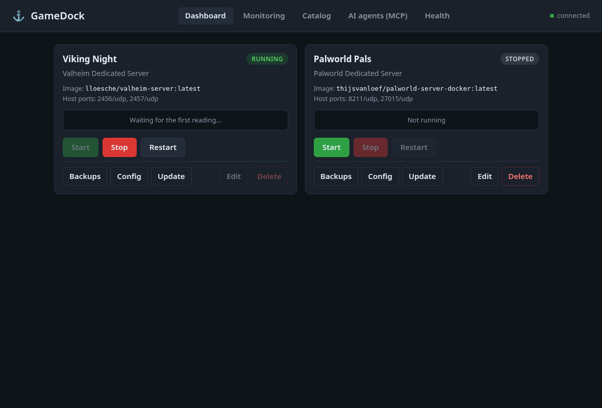

A server that is still downloading its game files shows **Installing 52%** instead of "Running", with a bar:

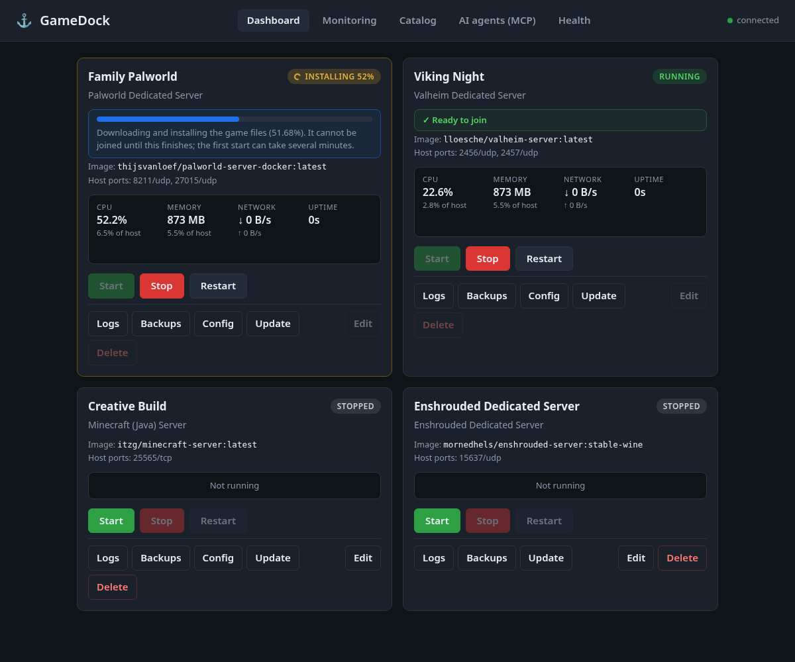

**New in 0.5.0:** adding a game is now a written, repeatable procedure ([docs/ADDING_A_GAME.md](docs/ADDING_A_GAME.md)), and your AI agent can do much of the work through MCP: it reads the guide, inspects the Docker image (without downloading it), validates and adds a catalog entry. An entry an AI added is marked **Added by AI, needs your review** and cannot be deployed until you read it and press **Approve**.

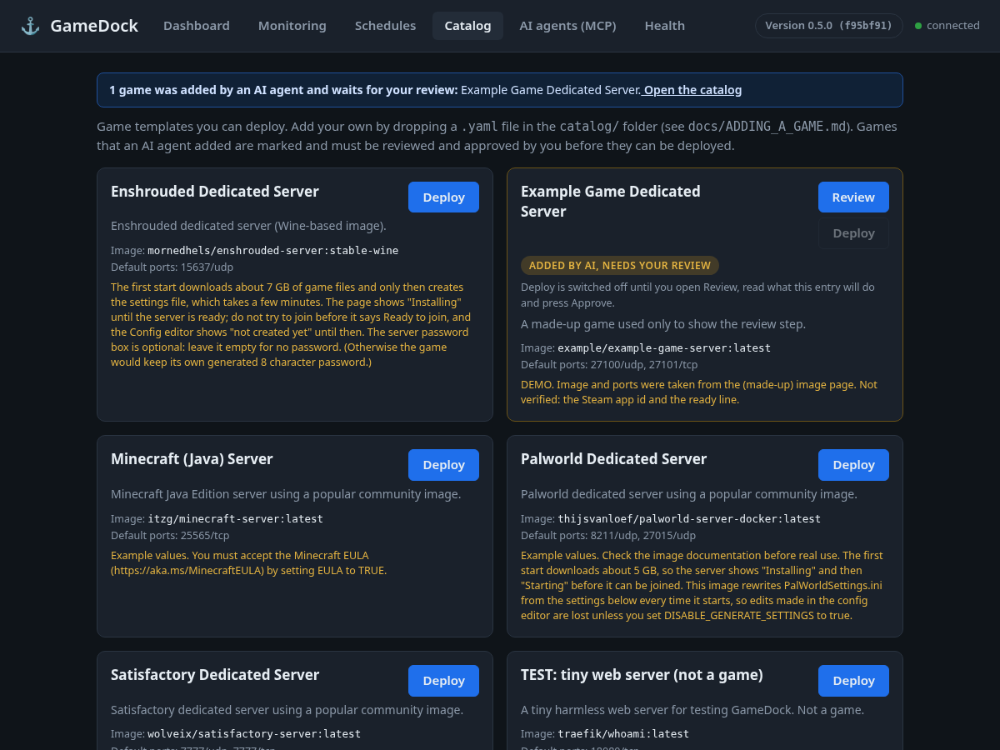

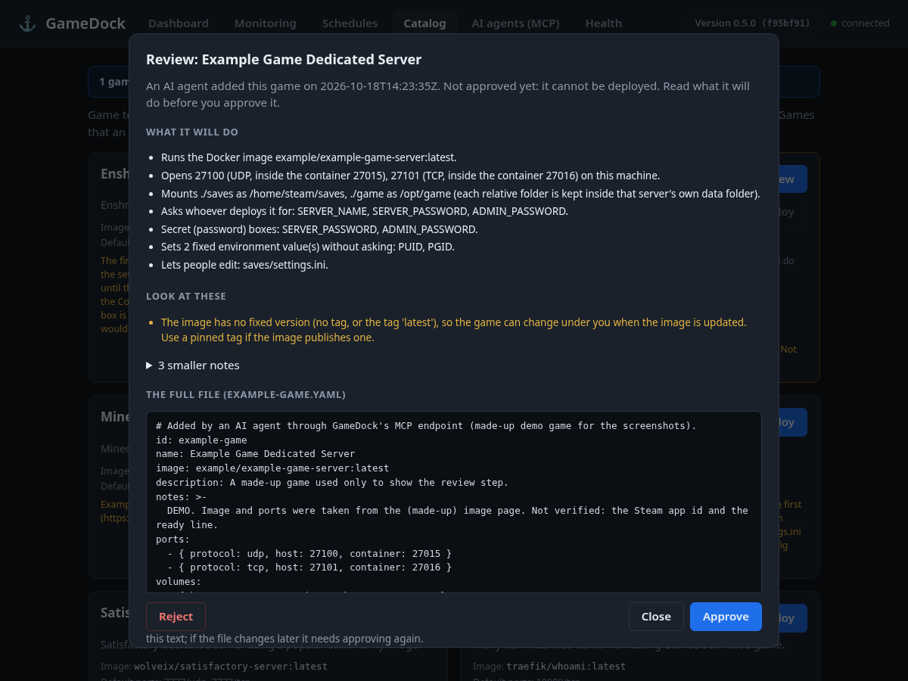

**New in 0.4.0:** each Steam-based server shows its own **game version** and whether a newer one is out, with an **Update game now** button (safe backup, restart, then a check that the game really changed). Scheduled maintenance applies game updates too.

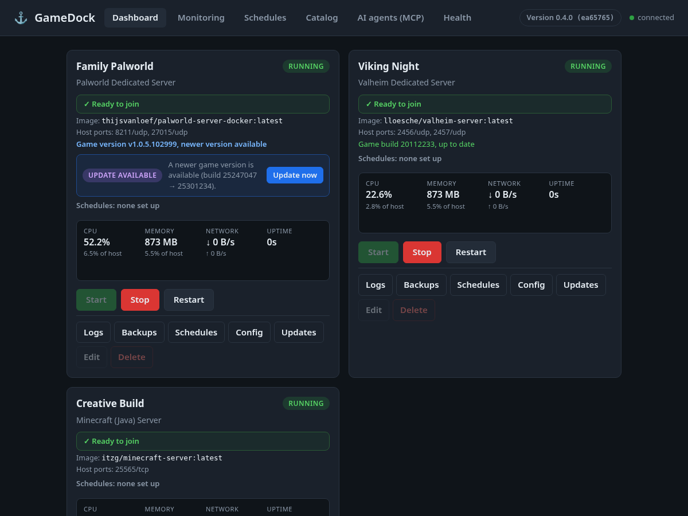

**New in 0.3.0:** the page header shows the GameDock version and says when a newer one is ready, with an **Update GameDock** button. Each server shows when a newer game image is available, and can back itself up and do its regular maintenance on a schedule.

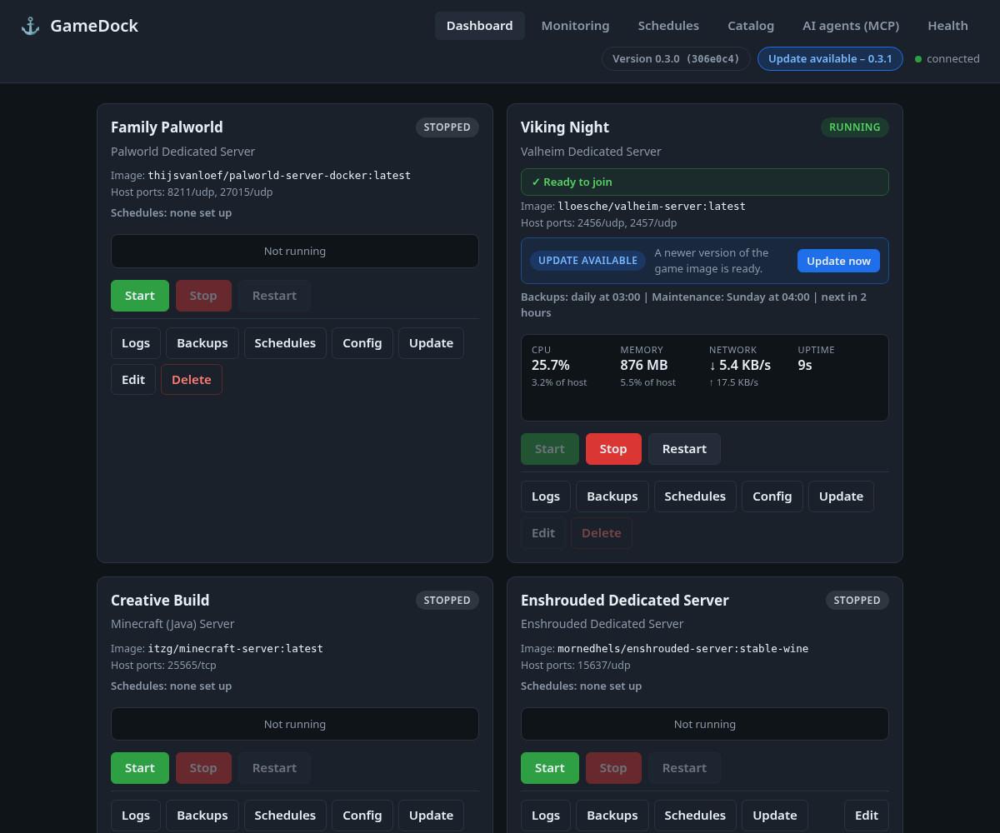

**What you get**

- A catalog of game templates; deploy several servers of the same game on different ports.
- Start / stop / restart, edit settings, update the image, delete safely. Every action shows what it is doing (spinner and bar) from the first click.
- Honest status: **Starting**, **Installing NN%** and **Ready to join**, not just "Running" (see [Ready versus running](#ready-versus-running)).
- A log viewer for each server (last 200 lines, follow mode, copy).
- Backups and restore of each server's data folder (always a safety backup first).
- An editor for the game's config files: a form with labelled fields, switches and hidden passwords, or the raw text. Changed fields are highlighted before you save.
- Live CPU, memory and network per game, plus host totals. No database needed.
- **Updates you can see:** the version and an "Update available" badge in the header (checks GitHub, works offline, one click to update GameDock itself), and an "Update available" badge on each server whose game image has a newer version.
- **Game versions:** for SteamCMD games, the installed game version and Steam build, whether a newer public build exists, and **Update game now** (see [A game's own version](#a-games-own-version-steamcmd-games)).
- **Schedules:** automatic backups (every few hours, daily, or on chosen weekdays, with how many to keep) and regular maintenance (back up, apply updates to the game and its image, restart) for each server.
- A **Health** page and a `doctor` command that tell you in plain language what is wrong and how to fix it.
- A step-by-step guide for adding new games ([docs/ADDING_A_GAME.md](docs/ADDING_A_GAME.md)), a template (`catalog/_template.yaml`), and MCP tools so an AI agent can research, validate and add an entry that you then review and approve.
- An optional MCP endpoint for AI agents (read-only, standard or full mode, with two-step confirmation for anything destructive).

**Version:** 0.5.1. See [CHANGELOG.md](CHANGELOG.md). How it is built: [docs/ARCHITECTURE.md](docs/ARCHITECTURE.md).

## Quick start

You need Linux with Docker Engine, Python 3.10 or newer, and a user that can run `docker ps` without `sudo`. (No Docker? Skip to the "fake engine" line below to try the screens.)

```bash
git clone https://github.com/jacobbweber/GameDock.git
cd GameDock
python3 -m venv .venv
. .venv/bin/activate
pip install -e .
cp .env.example .env          # optional; every setting has a safe default
python -m gamedock doctor     # checks Docker, folders, ports; tells you what to fix
python -m gamedock            # then open http://127.0.0.1:8080
```

- Try it without Docker: `GAMEDOCK_BACKEND=fake python -m gamedock` (a pretend engine; nothing real is created).
- Reaching it from another computer: do **not** open it to the network. Use an SSH tunnel (see [docs/NIMO_FIRST_TEST.md](docs/NIMO_FIRST_TEST.md)).
- Run it all the time: see [Running it as a service](#running-it-as-a-service).
- First time on a real machine? Follow the step-by-step list in [docs/NIMO_FIRST_TEST.md](docs/NIMO_FIRST_TEST.md). It starts with a tiny harmless test container.

## Concepts

- **Catalog entry**: a game template in `catalog/*.yaml` (image, default ports, volumes, the settings you can fill in).
- **Server**: a deployed instance made from a catalog entry. It has its own name, host ports and settings, and is stored in `data/instances.json` (mode 0600, because it can hold passwords; `data/` is git-ignored). A server keeps a snapshot of its template, so later catalog edits never break it.
- **Container**: GameDock creates one Docker container per server, named `gamedock-<server id>`, and labels it `gamedock.managed=true`. It only ever touches containers carrying that label.

## Configuration

Set these as environment variables or in a `.env` file in the folder you start GameDock from. Everything is optional.

| Variable | Default | Meaning |
|---|---|---|
| `GAMEDOCK_HOST` | `127.0.0.1` | Address the web page listens on. Keep it local. Only use `0.0.0.0` if you accept that anyone who can reach the port controls your servers (there is no login yet). |
| `GAMEDOCK_PORT` | `8080` | Web port. |
| `GAMEDOCK_ALLOWED_HOSTS` | *(empty)* | Extra names you type in the browser (comma separated, e.g. `gamedock.lan:8080`). `localhost`, `127.0.0.1` and the bind address always work. Other names get a "421 Host not allowed" (protects against DNS rebinding). |
| `GAMEDOCK_CATALOG_DIR` | `./catalog` | Folder of game definition files. |
| `GAMEDOCK_DATA_DIR` | `./data` | Server data, backups and `instances.json`. Relative volume paths go under `<data>/<server id>/`. |
| `GAMEDOCK_BACKEND` | `docker` | `docker` (real) or `fake` (pretend, for trying and testing). |
| `GAMEDOCK_STOP_TIMEOUT` | `60` | Seconds a game gets to save and exit when stopped (5 to 600). Also set on the container, so a host shutdown waits as long. Raise it for big worlds. |
| `GAMEDOCK_BACKUP_RETENTION` | `10` | Backups kept per server; the oldest are removed after each new one. |
| `GAMEDOCK_STATS_ENABLED` | `true` | Run the background sampler that feeds the live numbers. |
| `GAMEDOCK_STATS_INTERVAL` | `10` | Seconds between samples (2 to 300). |
| `GAMEDOCK_STATS_HISTORY_SECONDS` | `3600` | History kept in memory (60 to 86400); at most 2000 points per server. |
| `GAMEDOCK_METRICS_ENABLED` | `false` | Serve Prometheus text at `/metrics`. |
| `GAMEDOCK_METRICS_ALLOW_REMOTE` | `false` | Let non-local clients read `/metrics`. |
| `GAMEDOCK_SCHEDULER` | `true` | Run scheduled backups and maintenance. `false` keeps the settings but runs nothing (the Run now buttons still work). |
| `GAMEDOCK_UPDATE_CHECK` | `true` | Look on GitHub (read-only, at most every 6 hours, plus the Check now button) for a newer GameDock, and ask the Steam data service for the newest game builds (cached for an hour). `false`: GameDock contacts neither and says so. |
| `GAMEDOCK_STEAM_INFO_URL` | `https://api.steamcmd.net/v1/info/{appid}` | Where newest Steam build ids come from. Any address that serves the same JSON (`data.<appid>.depots.branches.<branch>.buildid`); `{appid}` is replaced by the app id. |
| `GAMEDOCK_UPDATE_REPO` | `jacobbweber/GameDock` | The GitHub repository to compare with, as `owner/name` or its URL. Only api.github.com is ever contacted. |
| `GAMEDOCK_SELF_UPDATE` | `true` | `false` hides the **Update GameDock** button (the version and badge stay; the page shows the manual commands). |
| `GAMEDOCK_MCP_MODE` | `standard` | `off`, `read_only`, `standard` or `full` (see [AI agents](#ai-agents-mcp)). Forced to `off` when `GAMEDOCK_HOST` is not localhost and no token is set. |
| `GAMEDOCK_MCP_TOKEN` | *(empty)* | Optional bearer token clients must send to `/mcp`. |
| `GAMEDOCK_MCP_ALLOWED_HOSTS` | *(empty)* | Extra `Host` values `/mcp` accepts, comma separated. |
| `GAMEDOCK_MCP_ALLOWED_ORIGINS` | *(empty)* | Extra `Origin` values `/mcp` accepts (browser-based MCP clients). |

## Using it

1. Open **Catalog** and press **Deploy** on a game.
2. Pick a name, check the host ports (a port already used by another server, or by anything else on the machine, is refused) and fill in the settings. Password settings are never shown again, logged or returned by the API.
3. Tick **Start after deploy** if you want it running right away. Deploy creates the container either way. The first deploy of a game downloads its image, which can take a while for big games.
4. On the **Dashboard**: Start / Stop / Restart, **Edit** (the server must be stopped; its container is recreated; leave a password blank to keep the stored one) and **Delete**.
5. If something looks wrong, open **Health**. A red banner at the top of every page appears when Docker is not reachable.

## Ready versus running

Docker says a container is "running" as soon as its process starts, but many games then spend minutes downloading or generating files and cannot be joined yet. GameDock therefore reports a phase for every running server:

| Phase | Meaning |
|---|---|
| **Starting** | The container is up but the game is not ready (health check still `starting`, or the ready line has not appeared). |
| **Installing NN%** | The game is downloading its files and the log shows a percentage (SteamCMD prints lines such as `Update state (0x61) downloading, progress: 51.68`). It cannot be joined yet. |
| **Ready to join** | Docker's health check says `healthy`, or the catalog's `ready_log_pattern` was seen in the log. |
| **Unhealthy** | The health check says `unhealthy` and no download is in progress. |

How it is decided, in order: (1) `State.Health.Status` from Docker if the image has a health check; (2) otherwise, or in addition, the catalog's optional `ready_log_pattern` (a regular expression searched in the log since the container started); (3) a download percentage from `progress_log_pattern` (one capture group) in the recent log lines keeps the server in **Installing** even when the health check has already gone `unhealthy` (some images give up on the health check during a long first download); (4) an image with no health check, no pattern and no download in its log is reported **Ready** as soon as it runs, as before. Healthy servers cost no log reads, and logs of the others are read at most every 2 seconds per server.

While GameDock itself is doing something to a server (deploying, starting, stopping, restarting, updating, backing up, restoring, wiping, saving settings) the card, the API (`activity`) and the MCP status tools say so, even after a page reload. A deploy shows a "Deploying" tile immediately while the image downloads.

## Logs

Press **Logs** on a server card for the end of its container log: 100 / 200 / 500 / 1000 lines, **Follow** (refreshes every 3 seconds, stays scrolled to the end), **Refresh** and **Copy**. Colour codes are removed and progress lines that rewrite themselves with carriage returns are shown once. Values of the server's secret settings are replaced by `********` if they appear in the log. Also available as `GET /api/servers/{id}/logs?lines=200` and the MCP tool `get_server_logs` (read-only, 100 lines by default, at most 500 lines and 40 000 characters).

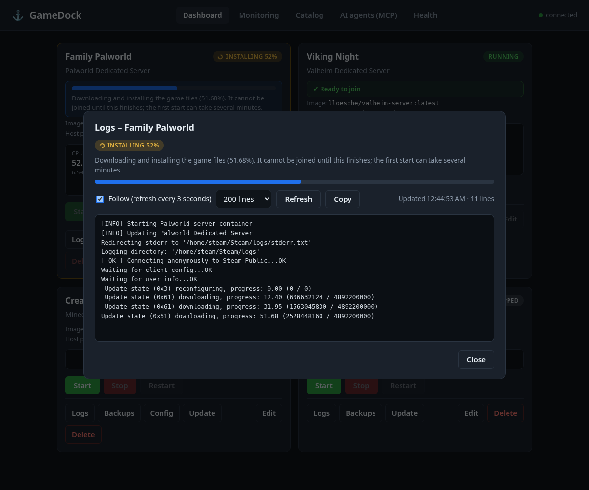

## Health check (`doctor`)

```bash
python -m gamedock doctor            # plain text, exit code 1 if something must be fixed
python -m gamedock doctor --json     # same, for scripts
```

The same checks run from the **Health** page (and `GET /api/doctor`). Each line says OK, Warning, Problem or Note, and every problem comes with the fix. It looks at:

- the `docker` command, whether the Docker service answers, and whether this user may use it;
- the data folder (writable? free space: warns under 5 GB, fails under 512 MB) and whether the list of servers can be read;
- file owners inside the data folder (files owned by another user, usually root, break backups);
- every catalog file (broken files are named and skipped, the rest still load);
- the host ports of your deployed servers (it tries to bind them; a stopped server's port that something else grabbed is flagged);
- the web address and the MCP mode / token.

It changes nothing. Run it first on any new machine, and again whenever something is odd.

## Backups and restore

Every server has a **Backups** panel (dashboard card, "Backups" button).

- **Create backup** writes `<data>/backups/<server id>/<server id>-YYYYMMDD-HHMMSS.tar.gz` (UTC time in the name) containing the server's data folder (`<data>/<server id>/`). No sudo is used.
- **Consistent by default:** if the server is running, GameDock stops it, takes the backup and starts it again, and tells you so. Tick "Back up without stopping (live)" to skip that; the result then warns the files may be inconsistent.
- **Retention:** only the newest N backups per server are kept (default 10, `GAMEDOCK_BACKUP_RETENTION`), applied after every new backup.
- **Restore** needs a stopped server and confirmation. Before replacing anything GameDock takes an automatic safety backup (`...-pre-restore.tar.gz`); if that fails the restore is cancelled. The archive is checked first (no `..`, absolute paths, or links pointing outside) and unpacked beside the data folder before being swapped in, so a damaged backup never touches your current data.
- **Delete backup** needs confirmation.
- **Wipe data** (empties the data folder, keeps the server) needs confirmation and a stopped server, and takes a `...-pre-wipe` backup first.
- **Delete server with its data** needs two confirmations (`confirm` and `confirm_delete_data`), a stopped server, and first saves a backup outside the data folder at `<data>/backups/_deleted/<id>-<time>-pre-delete.tar.gz`. If that backup fails nothing is deleted.
- **Permissions:** GameDock runs as its own user. If a game container wrote files as another user (often root) that GameDock cannot read, the backup stops with a clear message (and the `chown` command that would fix it), nothing partial is left, and any operation that needed the backup first (restore, wipe, delete with data, update) is cancelled.
- Only the server's own data folder is saved. Volumes with an **absolute** host path in a catalog entry live outside it and are not backed up. Backups are taken and restored as the GameDock user, so file ownership becomes that user's.

## Monitoring

Built in, light, and with no database or extra services (it does not need Prometheus).

- **Dashboard cards** show live CPU, memory, network rate and uptime for each running server, with small sparklines of the last ~10 minutes.
- **Monitoring page** shows host totals (CPU, memory, load, free disk on the volume holding the data folder, uptime) and a table ranking your servers by CPU or memory (click a column header), with each server's share of the whole host and a total row.
- CPU is shown the way Docker does: 100% is one full core. "Of host" divides by the number of cores.
- **How it stays cheap:** a background thread samples every `GAMEDOCK_STATS_INTERVAL` seconds (default 10). Each sample makes at most two Docker calls for *all* servers together (`docker inspect` for state and start times, and `docker stats --no-stream` for the running ones), never one per server. If nothing is running it makes just the one small inspect call, at half the normal rate, and records nothing; with no servers deployed it makes no Docker call. Host numbers come from `/proc` and `shutil`.
- **History** lives in fixed-size in-memory ring buffers (about one hour at the default settings, hard-capped at 2000 points per server), so memory use is bounded and it resets when GameDock restarts. Stopping or deleting a server drops its history.
- Network and block I/O are cumulative counters from Docker; the UI shows network as a rate computed between samples.

### Optional Prometheus / Grafana

Off by default. To let your own Prometheus scrape GameDock, set `GAMEDOCK_METRICS_ENABLED=true`. GameDock then serves Prometheus text format at `/metrics`, built from the sampler's latest reading (so a scrape never triggers extra Docker calls). It answers only clients on the same machine unless you also set `GAMEDOCK_METRICS_ALLOW_REMOTE=true` (and make GameDock reachable with `GAMEDOCK_HOST`; there is no login, so only do that on a network you trust).

Prometheus on the same host:

```yaml
scrape_configs:
  - job_name: gamedock
    scrape_interval: 15s
    static_configs:
      - targets: ["127.0.0.1:8080"]
```

If Prometheus runs in a Docker container it does not appear as `127.0.0.1` to GameDock, so you need `GAMEDOCK_METRICS_ALLOW_REMOTE=true` and a `GAMEDOCK_HOST` it can reach.

Metrics (labels `server` = server id, `game` = catalog id):

| Metric | Type | Meaning |
|---|---|---|
| `gamedock_server_running` | gauge | 1 if the container runs |
| `gamedock_server_cpu_percent` | gauge | 100 = one core |
| `gamedock_server_memory_bytes`, `gamedock_server_memory_limit_bytes` | gauge | memory in use / limit |
| `gamedock_server_network_receive_bytes_total`, `..._transmit_bytes_total` | counter | since container start |
| `gamedock_server_block_read_bytes_total`, `..._block_write_bytes_total` | counter | disk I/O since container start |
| `gamedock_server_uptime_seconds` | gauge | running servers only |
| `gamedock_servers`, `gamedock_build_info{version}` | gauge | count of servers, version |
| `gamedock_host_cpu_percent`, `gamedock_host_cpu_count`, `gamedock_host_load1` | gauge | host CPU |
| `gamedock_host_memory_total_bytes`, `gamedock_host_memory_used_bytes` | gauge | host memory |
| `gamedock_host_disk_total_bytes`, `gamedock_host_disk_free_bytes` | gauge | volume with the data folder |

Example Grafana queries: `gamedock_server_cpu_percent` (one line per game), `sum(gamedock_server_memory_bytes)`, `rate(gamedock_server_network_transmit_bytes_total[5m])`.

## Updating a server

**Update** (dashboard card) pulls the newest version of the server's image and recreates the container, keeping data and settings. GameDock pulls first; if the image is already the newest, nothing else happens. Otherwise it stops the server if running (with the stop grace period, default 60 s), takes an automatic `...-pre-update` backup (if that fails the update is cancelled and the server is restarted), recreates the container and starts it again if it had been running. The image id before and after is shown. A catalog entry can set `update_method: none` for games that update themselves inside the container (the Update button then disappears).

## Updates: GameDock and your game servers

### GameDock itself

The header shows `Version 0.3.0 (abc1234)`: the version and the short git commit. GameDock asks GitHub (`GAMEDOCK_UPDATE_REPO`) for the newest commit at most every 6 hours (a failed check is retried after 30 minutes) and when you press **Check now** in the version dialog. It only reads; nothing is sent. Offline is not an error: the dialog says it could not check and when it last did. When the repository is ahead of your copy, a blue **Update available** badge appears next to the version.

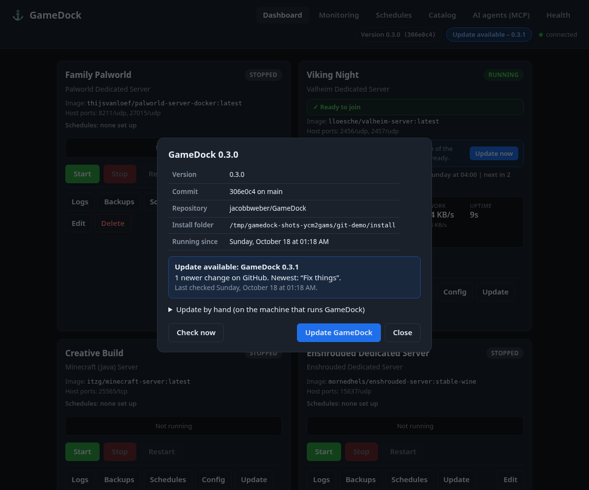

**Update GameDock** (after a confirmation) runs `git pull --ff-only` in the install folder and restarts GameDock only; your game servers keep running. The page waits, reconnects by itself and shows the new version. It refuses, changing nothing, when:

- the install folder is not a git checkout on a branch (for example the Docker image), or has local changes to GameDock's own files;
- a backup, update, restore, deploy or scheduled job is running (starting an update also blocks new actions for a few seconds);
- the pull would not be a plain fast-forward (you have your own commits);
- the update changes the packages GameDock needs (`requirements.txt`, or the dependency lines of `pyproject.toml`; a change of only the version line is fine from 0.4.0 on); it then tells you to run `.venv/bin/pip install -e .` by hand first.

In every refusal the dialog shows the exact commands to run by hand. The restart asks systemd (`systemctl --user restart gamedock`); if that is not possible it exits with code 75 so a unit with `Restart=on-failure` or `Restart=always` starts it again; outside systemd it starts itself again in place. Updating GameDock is web only: it is deliberately not an MCP tool, so an AI agent cannot replace the program it runs in. Agents can read the version with `get_gamedock_version`.

### A game's own version (SteamCMD games)

The game files of a Steam game server and the container image around them are two different things. For catalog entries with a `steam_app_id` (Palworld, Enshrouded, Valheim and Satisfactory ship with one; Minecraft is not a Steam game and has none), GameDock tracks the game itself:

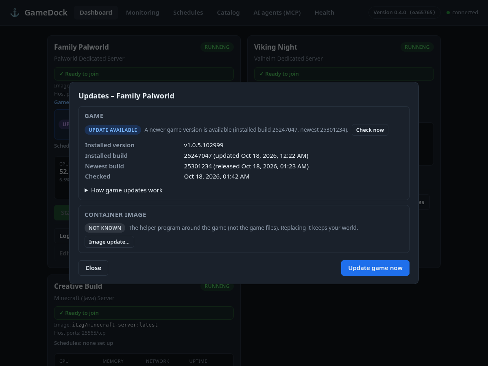

- **Installed:** the Steam *build id* and its date, read from `steamapps/appmanifest_<app id>.acf`, the record SteamCMD keeps in the game's folder. GameDock looks for it in the server's volumes (a bounded search, symlinks not followed), or in `steam_manifest_dir` if the entry names one. The game's own version text (for example `v1.0.5.102999`) comes from the log with the entry's `version_log_pattern`, and is remembered together with the build it belongs to.
- **Images without a Steam record:** some images (Enshrouded's) keep no `appmanifest` file, only a small version file. The entry can name it with `installed_build_file` (a path inside the server's data folder, so the game's folder must be a volume). Its first line is the installed version: a plain number is taken as the Steam build id and compared; any other text is shown but cannot be compared, and the dialog says so. If neither the file nor a Steam record can be read, the dialog says that plainly.
- **Newest:** the newest *public* build id (or `steam_branch`), asked of a public mirror of Steam's data (`https://api.steamcmd.net/v1/info/<app id>`, no account; change the address with `GAMEDOCK_STEAM_INFO_URL`, use `{appid}` as the placeholder). The answer is cached for one hour, in memory and in `<data>/steam-latest.json`, so restarting GameDock does not ask again. Offline, rate limited or a broken answer is never an error: the page says **Could not check**. `GAMEDOCK_UPDATE_CHECK=false` switches this check off together with the GitHub one.
- **Status:** **Up to date**, **Update available**, **Could not check**, or **Unknown (no Steam id for this game)**. The tile has a line such as "Game version v1.0.5.102999, up to date" and, when a newer build exists, an **Update available** badge (in purple for a game update, blue for an image update; if both apply there is one badge and the **Updates** dialog has the details).
- **Update game now** (`game_update_method: restart`, the default when a `steam_app_id` is set) needs the server to be running. It stops the server, takes a safety backup, starts it again (these images download the new game files while they start, the image setting is usually called `UPDATE_ON_BOOT`), then waits and reads the installed build id again. If the build did not change it says so plainly ("the game did not update on restart; check the logs") and leaves the server running. A stopped server updates when you start it.
- **Scheduled maintenance:** with *apply updates* ticked, the run asks whether a newer game version exists. If so, the restart installs it (even if *restart* is not ticked, because the update needs one) after a backup, and the result says "updated from build A to build B", or that it did not. If there is none, it only restarts when *restart* is ticked. If the check fails the run still goes on and says so.
- **Limits:** the tile never waits on the network (it shows the last answer; a background check refreshes it every hour, and **Check now** asks at once). A game whose install folder is not one of the server's volumes (the files live only inside the container) cannot be read: the dialog says it could not find the Steam record, and you can add the folder as a volume. The mirror is third-party data: GameDock only reads two numbers from it.

AI agents: `check_game_update` (read-only and above) and `update_game` (standard and full), see below.

### A game server's image

A tile whose image has a newer version shows **Update available** and an **Update now** button (the existing safe update, with a backup first; it is also reachable from the **Updates** dialog under *Container image*). GameDock compares the digest of the image the container was made from with the registry's digest for the same tag, without downloading anything. The answer is cached for hours (at most one registry question per server per 30 seconds; the **Update** dialog has a **Check now** button), and it is kept in memory only, so it resets when GameDock restarts. Many SteamCMD-based images download the newest *game* files every time the container starts; for those, restarting is what updates the game, and the badge only means the wrapper image changed. A catalog entry can say so in its own words with `update_note`.

## Schedules: backups and maintenance

Open **Schedules** (top menu) or the **Schedules** button on a server.

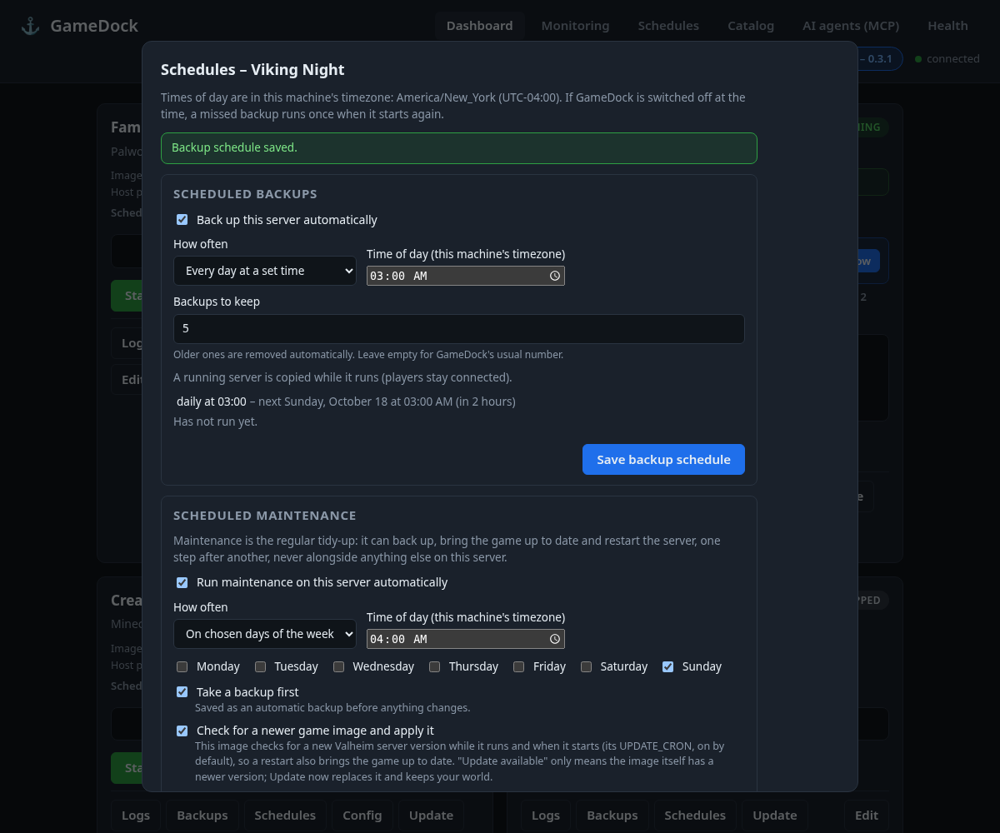

- **Backups:** every N hours (1 to 168), every day at a time, or on chosen weekdays at a time, plus how many scheduled backups to keep (default: the usual `GAMEDOCK_BACKUP_RETENTION`). They are marked *scheduled* in the Backups list and are pruned separately from manual ones. A catalog `save_command` (for example `rcon-cli save`) is run in the container first, and `backup_stop_first: true` stops the game briefly for a consistent copy, as for manual backups.
- **Maintenance:** daily or on chosen weekdays, with checkboxes: take a backup first, check for and apply updates (a newer game version for Steam games, and a newer image), restart. *Only when nobody is playing* is shown but not available: GameDock has no generic way to count players, and the page says so. A step that does not apply (no image update for this game) is skipped and explained.
- Every schedule shows its **last run**, **next run** and **last result**; failures are shown in red on the tile, in the panel and in the activity log. **Run maintenance now** asks for confirmation first.
- Times of day are in the machine's timezone (shown on the page); daylight-saving changes are handled (a time that is skipped that day, such as 02:30 when the clocks jump forward, runs an hour later, and a repeated hour runs once).
- If GameDock was off at the scheduled time, a missed **backup** runs once when it starts. A missed **maintenance** runs once if it is less than 6 hours late and is otherwise skipped (never a surprise restart), with a note.
- GameDock never does two things to one server at once: a job that finds the server busy tries again at the next 30-second check, and is recorded as skipped if the server stays busy for two hours.
- Schedules are stored in `<data>/schedules.json` (written atomically). A damaged file is set aside as `schedules.json.broken-<time>` and the Schedules page says so.
- Runs started by a schedule are written to the same activity log as AI agent calls (`<data>/mcp-audit.jsonl`, shown on the AI agents page).
- AI agents can read schedules (`list_schedules`) and, in `standard` and `full` modes, set them (`set_backup_schedule`, `set_maintenance_schedule`). Setting a schedule runs nothing and cannot lose data.

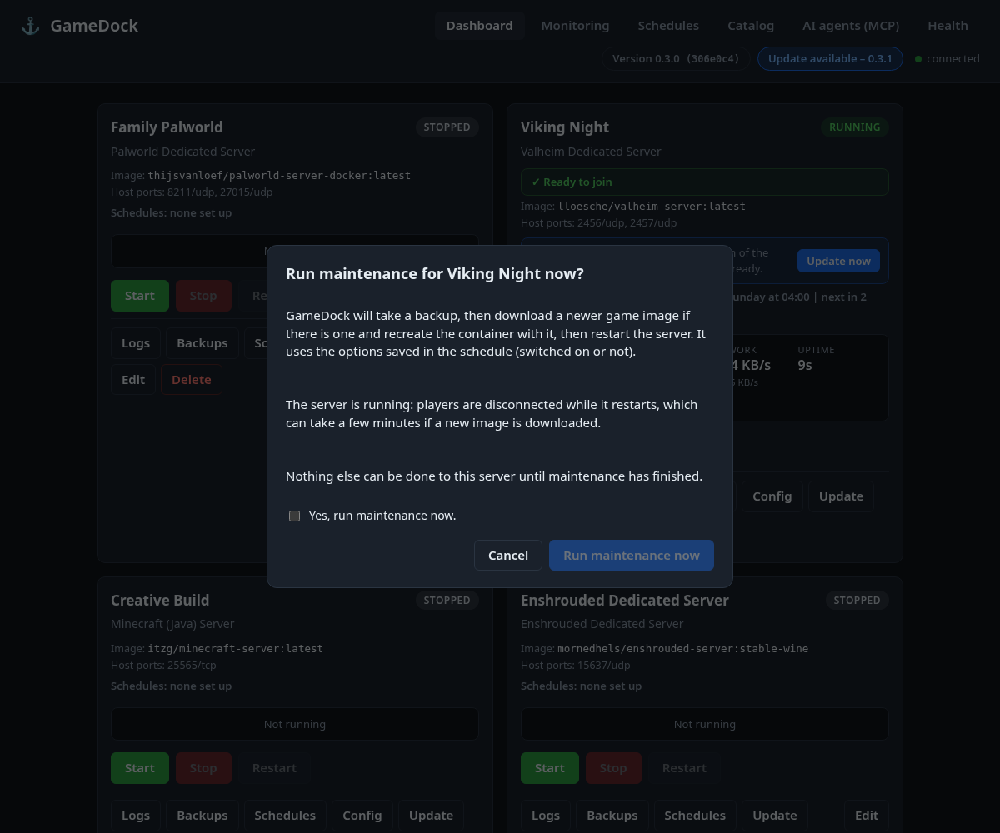

## Editing config files

A catalog entry can declare config files; each server then gets a **Config** button with a text editor.

- Only declared files can be opened, and the path must stay inside the server's data folder: `..`, absolute paths, and symlinks (to outside or inside) are refused.
- Files are limited to 256 KB of UTF-8 text. JSON files are validated before saving.
- Every save first copies the old file to `<name>.<timestamp>.bak` beside it (the newest 10 are kept) and then replaces it atomically.
- Saving is refused while the server runs unless the catalog marks the file `hot_edit: true`. Most games need a restart to pick up changes; the editor says so.
- `sensitive_keys` values (passwords) are shown as `********`. Leave the placeholder to keep the real value; type over it to change it. Works for `key=value`, `key: value`, JSON and inline `Key="value"` styles.
- **Settings form and raw text.** For files in a format GameDock understands, the editor opens as a form: one labelled row per setting (the file's own key is shown under the label), a switch for `True` / `False`, number and text inputs, password inputs for `sensitive_keys`, a search box and two filters, **Only changed in this session** and **Only differing from default**. Rows changed in this session are highlighted, show `was: ...` with an **Undo** button, and are listed in a review box before you save (that list is only about the current session and clears after Save). A toggle switches to the raw text at any time. Understood formats: Palworld-style `OptionSettings=(Key=Value,...)` (quoted values with commas, escaped quotes and nested `(a,b)` lists), `key=value` ini / properties files (with `[sections]`), and flat JSON. Only the characters of values you changed are replaced, so everything else in the file (comments, order, spacing, unusual quoting) stays byte-for-byte the same. A file in another format simply opens as raw text.
- **What differs from the default (0.5.2).** The first time GameDock sees a settings file that exists (deploy time for a new server, otherwise the first time you open or save it), it records a *baseline*: the parsed list of settings, not the file text. From then on every row that differs from that default carries a blue **Not default** pill and a muted line `Default: <value>` with a **Reset to default** button (it only fills the field; you still press Save). The bar above the list says `N settings differ from the default`, **Reset all to defaults** (asks first, fills the form only, leaves passwords alone) and the **Only differing from default** filter work after saving, closing and reopening, because the comparison is done on the server against the baseline. A setting that is in the file but was not in the defaults is labelled **New**; one that was in the defaults but is gone from the file is listed under **Missing from file**. Values are compared by meaning: `1`, `1.0` and `1.000000` are equal, `True` equals `true`, surrounding spaces are ignored, arrays and objects are compared as JSON. Password settings (`sensitive_keys`) are never stored: they show only `set` / `not set`, and count as different only when that changes or a new one is typed (they are not compared by value).
- **Where the baseline lives and what it can know.** `<data>/config-baselines/<server id>/<sha1 of the file path>.json` (mode 0600, outside the game's own folders; the server id, not the name, is the key). It is never overwritten automatically. A file that was already edited before GameDock first looked at it (every server that existed before 0.5.2 gets its baseline the first time you open or save it) has a baseline equal to its file at that moment, so earlier changes cannot be shown; the dialog says `Defaults were first recorded just now, so earlier changes cannot be shown` and afterwards where and when the defaults were taken. **Record current settings as the default…** (asks first) deliberately replaces the baseline with the saved file; the old one is kept once as `<sha1>.prev.json`. A game update that changes the game's own defaults is not noticed: the baseline stays what it was. The baseline is deleted when the server is deleted together with its data, or when its data is wiped, and kept when the server is deleted but its data folder is kept (the files and their defaults are still there); it is not part of backups (it is only GameDock's own record, not game data). Changes to the baseline files are not possible from the MCP endpoint.
- The form only prepares the new text; saving still goes through the same checks as the raw editor (`.bak` copy, path rules, masking, `hot_edit`).
- If the game has not created its settings file yet, the editor says: "This game has not created its settings file yet; it appears after the first full start." (You can still write the file yourself.)
- Some images regenerate the file from environment variables on every start (Palworld does, unless `DISABLE_GENERATE_SETTINGS=true`). A catalog `note` on the config file shows such a warning above the editor.

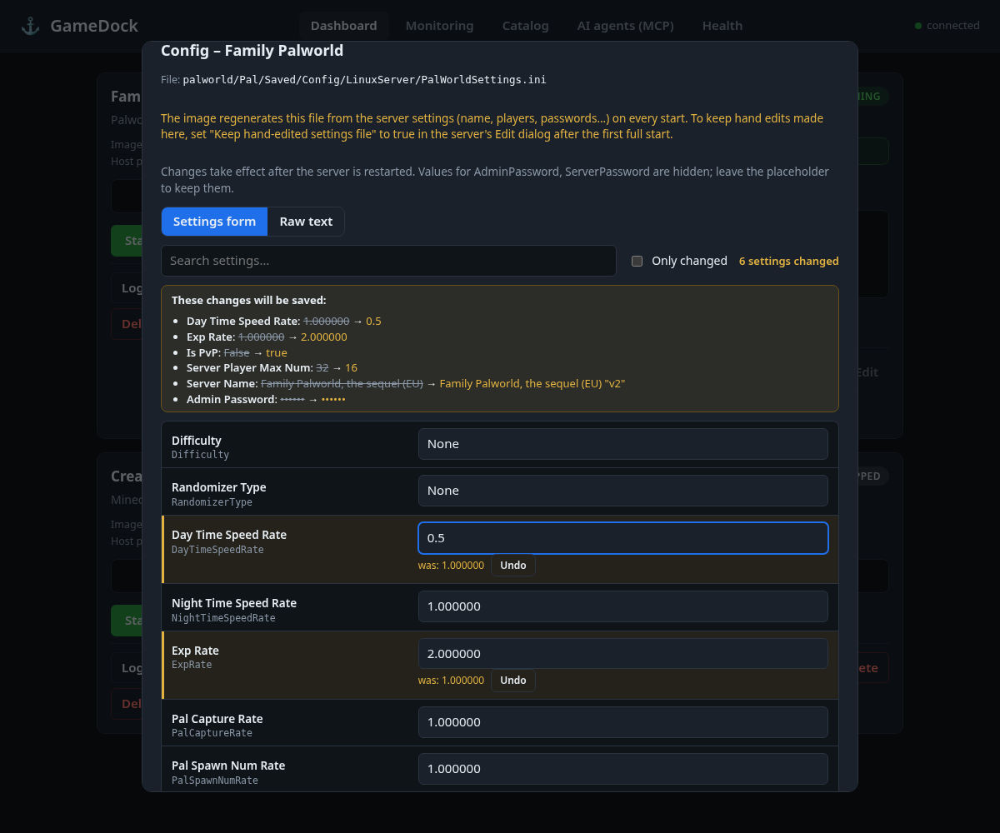

## Adding a game to the catalog

**The full, step-by-step procedure (for people and for AI agents) is [docs/ADDING_A_GAME.md](docs/ADDING_A_GAME.md):** the ten steps, a table of every catalog key, the traps learned from Palworld and Enshrouded, and a verification checklist. Start from `catalog/_template.yaml` (files starting with `_` are ignored by the catalog). To let an AI agent do it, give it [docs/PROMPT_ADD_A_GAME.md](docs/PROMPT_ADD_A_GAME.md) and see [Adding a game through MCP](#adding-a-game-through-mcp) below. The short version follows.

Drop a `.yaml` file in `catalog/`. It shows up on the Catalog page after a reload, no restart needed. A file that cannot be read is skipped and named on the Health page and in the banner, so one typo never hides your other games.

All options:

```yaml
id: my-game              # lowercase letters, digits, - and _
name: My Game Server
image: some/image:tag
description: One line shown on the card.
notes: Shown in amber on the card (use it for warnings).
ports:                   # defaults; each server can choose its own host ports
  - { protocol: udp, host: 27015, container: 27015 }
volumes:
  - { host: ./saves, container: /saves }   # relative = under <data>/<server id>/
env:                     # fixed values, not editable in the deploy form
  SOME_FLAG: "1"
update_method: pull_recreate   # default; or 'none' if the game updates itself
update_note: "Shown in the Update dialog and Schedules: how this image updates the game."   # optional, plain words
steam_app_id: 2394010            # optional: Steam app id of the dedicated server; turns on game version tracking
steam_branch: public             # optional: Steam branch to compare with (default public)
steam_manifest_dir: palworld     # optional: folder (inside the server's data folder) holding appmanifest_<id>.acf; default: search the volumes
version_log_pattern: "Game version is (v?[0-9.]+)"   # optional regex, ONE group: the game's version text in its log
game_update_method: restart      # default 'restart' when steam_app_id is set: the image updates the game at start; or 'none'
installed_build_file: game/current_version   # optional: a small file (in the server's data folder) whose text is the installed version/build
stop_timeout: 90                 # optional: seconds this game gets to save when stopped (default: GAMEDOCK_STOP_TIMEOUT, 60)
save_command: [rcon-cli, save]   # optional: run inside the container before a scheduled backup (list, or a quoted string)
backup_stop_first: false         # true = stop the game briefly for scheduled and manual backups
ready_log_pattern: "Server is ready"   # optional regex: when this appears in the log the server is Ready
progress_log_pattern: "progress: *([0-9.]+)"   # optional regex with exactly ONE group: the download percentage
config_files:            # files users may edit (relative to the server's data folder)
  - path: saves/settings.ini
    label: Settings
    format: ini          # ini | json | yaml | text (json is validated)
    sensitive_keys: [AdminPassword]
    hot_edit: false      # true = safe to edit while running
    note: "Shown above the editor, e.g. a warning that the image rewrites this file on start."
fields:                  # settings shown in the deploy/edit form
  - { name: SERVER_NAME, label: Server name, default: "My Server", required: true }
  - { name: SERVER_PASSWORD, label: Password, secret: true }   # secret = password input
```

`ready_log_pattern` and `progress_log_pattern` are optional and only matter for images that take a while to become joinable; if the image has a Docker `HEALTHCHECK` that already says `healthy` at the right moment, you do not need them. Both are checked when the catalog loads (valid regex, one line, at most 300 characters; the progress pattern needs exactly one capture group). Find the right lines with the **Logs** button after a first start. The Palworld and Enshrouded entries are examples; the Enshrouded entry was checked against a real run (password variables, settings file, log lines).

### Worked example: the smoke-test entry

`catalog/smoke-test.yaml` is a real, working entry for a tiny harmless web server, handy for trying GameDock itself. Here it is, line by line:

```yaml
id: smoke-test                       # the short name; the container becomes gamedock-<server id>
name: "TEST: tiny web server (not a game)"   # what people see on the card
image: traefik/whoami:latest         # the Docker image to run (about 5 MB)
description: A tiny harmless web server for testing GameDock. Not a game.
notes: >-                            # amber warning text on the card
  Test entry only. ...
ports:
  - { protocol: tcp, host: 18080, container: 80 }   # host 18080 -> the program's port 80
volumes:
  - { host: ./data, container: /data }  # <data folder>/<server id>/data is mounted at /data
config_files:                        # gives the card a "Config" button
  - path: data/notes.txt             # relative to the server's folder
    label: Test notes (edit me)
    format: text
    hot_edit: true                   # editable while the server runs
    sensitive_keys: [api_key]        # values after "api_key" are hidden in the editor
fields:                              # the form the user fills in; each becomes an environment variable
  - { name: WHOAMI_NAME, label: Name shown in the answer, default: "gamedock-smoke-test" }
  - name: TEST_PASSWORD
    label: Test password (not used by the container)
    secret: true                     # password box, never shown again
```

### Turning a real game into an entry

1. Find the game's Docker image and read its page (Docker Hub or GitHub). Note the **ports** (and TCP/UDP), the **folder inside the container where it saves** (that becomes `volumes`), and the **environment variables** it understands (those become `fields` or `env`).
2. Copy `catalog/smoke-test.yaml`, change the id, name, image, ports, volumes and fields.
3. Check **who the container writes files as**. If the image supports `PUID` / `PGID`, add them to `env` with your user's numbers (`id -u`, `id -g`) so backups can read the files.
4. Open the Catalog page (or run `python -m gamedock doctor`): a mistake in the file is reported in plain words.
5. Deploy it with the fake engine first (`GAMEDOCK_BACKEND=fake`), then for real.

Rules every entry must follow (checked when the file loads): no privileged mode, host networking, device mappings, extra capabilities or Docker socket mount, a normal image name, valid ports and patterns. Entries **added by an AI agent** are held to stricter rules (only documented keys, relative host folders, host ports 1024 and up, at most 20 KB) and need your approval; see below.

Never put real passwords in catalog files (they are committed to git); users type them into the form. A server keeps a snapshot of its template from deploy time, so changes to a catalog entry (fixed `env`, `fields`, `volumes`, `ports`, `stop_timeout`) only affect servers deployed afterwards; only the read-only hints (update note, Steam and version settings, `installed_build_file`) are taken from the current entry for older servers. Every setting's value is passed to the container, an **empty value too** (as `NAME=`, "present but empty"); some images, such as Enshrouded's, treat that differently from a missing variable.

**The bundled games (Enshrouded, Palworld, Valheim, Minecraft Java, Satisfactory) are examples.** Their images, ports and variables were written from general knowledge of popular community images and have not been run here. Check each against the image's own documentation before real use.

## AI agents (MCP)

GameDock serves a [Model Context Protocol](https://modelcontextprotocol.io) endpoint at **`/mcp`** on the same port as the web page (no extra process). It uses the official Python `mcp` SDK (2.x), Streamable HTTP, stateless. Every tool calls the same `GameDockService` methods as the web page, so the two can never disagree. The **AI agents (MCP)** page in the web UI shows the endpoint URL, the current mode, whether a token is set, copy-paste connection snippets and the recent activity.

### Modes (`GAMEDOCK_MCP_MODE`)

| Mode | Tools served |
|---|---|
| `off` | none (`/mcp` answers 404 with an explanation) |
| `read_only` | `list_catalog`, `get_catalog_entry`, `list_servers`, `get_server_status`, `get_server_stats`, `get_host_stats`, `get_stats_history`, `list_backups`, `list_config_files`, `read_config_file`, `get_config_changes`, `get_server_logs`, `get_gamedock_version`, `list_schedules`, `check_game_update`, and for adding games `get_add_game_guide`, `validate_catalog_entry`, `inspect_image` (18 tools) |
| `standard` (default) | read-only tools plus `deploy_server`, `start_server`, `stop_server`, `restart_server`, `update_server_settings`, `update_server_image`, `create_backup`, `write_config_file`, `set_backup_schedule`, `set_maintenance_schedule`, `update_game`, `add_catalog_entry`, `update_catalog_entry` (31 tools) |
| `full` | standard plus the destructive tools `delete_server`, `restore_backup`, `delete_backup`, `wipe_server_data` (35 tools) |

Tools outside the mode are not listed at all and cannot be called. If `GAMEDOCK_HOST` is not localhost and `GAMEDOCK_MCP_TOKEN` is empty, the mode is forced to `off` (a warning is logged and the web page explains why).

### Adding a game through MCP

An agent can help add a new game. The tools are `get_add_game_guide` (the procedure, a field reference and a template), `inspect_image` (read-only: it never downloads or runs an image; for an image already on the machine it shows the declared ports, volumes, user, environment variable names and health check, otherwise it says so and how to pull it, and it shows what the registry says), `validate_catalog_entry` (a dry run with exactly the checks of adding; saves nothing) and, in `standard` and `full` modes, `add_catalog_entry` and `update_catalog_entry`. The procedure is also the resource `gamedock://add-a-game` and the prompt `add_a_game`.

**The review rule.** `add_catalog_entry` validates strictly, then writes `catalog/<id>.yaml` (the file name comes from the validated id; nothing outside the catalog folder is ever written; an id that exists is refused, so nothing is overwritten) and records it in `<data>/catalog-review.json` (not in the repository) as added by MCP, **not reviewed**, with the file's SHA-256. Until a person approves it, the Catalog page shows **Added by AI, needs your review**, the Deploy button is off, and both the web API and `deploy_server` refuse it. **Review** shows a plain summary (image, ports, folders it will mount, secret fields, anything unusual) and the whole file; **Approve** records the fingerprint of exactly what was shown (if the file is changed afterwards by anyone it is unreviewed again); **Reject** deletes the file after a confirmation. These buttons exist only in the web page; there is no MCP tool for approving. `update_catalog_entry` works only on entries the agent itself added, never on entries from the repository (git-tracked files), and sends the entry back to "needs review". Every authoring call is in the audit log (the YAML itself is not logged, only a size and fingerprint).

### Destructive tools need two steps

`delete_server`, `restore_backup`, `delete_backup` and `wipe_server_data` never act on the first call. The first call changes nothing and returns a plain-language **summary** of exactly what would happen (including the automatic backup that is taken first) plus a **confirmation token**. Only a second call with the same arguments plus `confirmation_token` does it. Tokens last about 2 minutes, work once, are kept in memory only, and are tied to the exact action and arguments (change `delete_data` and the token is refused). A running server must be stopped first; that is reported before any token is issued. The built-in guide tells agents to show the summary to a human before confirming.

### MCP security

- Optional bearer token: set `GAMEDOCK_MCP_TOKEN` (for example `python -c "import secrets; print(secrets.token_urlsafe(32))"`); clients send `Authorization: Bearer <token>`. The comparison is constant-time and the token is never returned, shown or logged.
- `Host` header check against DNS rebinding: only localhost names (any port) and the bind address are accepted, plus `GAMEDOCK_MCP_ALLOWED_HOSTS`. When bound to `0.0.0.0` with nothing configured, the token is the protection.
- `Origin` check: a request that carries an `Origin` header (which is what a web page in a browser sends) is refused unless it is the same origin or listed in `GAMEDOCK_MCP_ALLOWED_ORIGINS`. Normal agent clients send no `Origin`.
- With no token and a localhost bind, any program on this machine can use the endpoint. Set a token if other users share the machine.
- Secret settings (passwords) are accepted as input, but no tool ever returns them, and the audit log masks them.
- `/mcp` has no TLS of its own. Put it behind a reverse proxy with HTTPS before exposing it beyond your LAN.

### Audit log

Every call (and every refused connection) is appended as one JSON line to `<data folder>/mcp-audit.jsonl` (mode 0600, rotated at 5 MB, one old file kept): `time` (UTC), `tool`, `args` (secret values and file contents masked), `status` (`ok`, `error`, `confirmation_required`, `token_rejected`, `invalid_arguments`, `unknown_tool`, `denied`, `crashed`), a short `detail` for problems and the caller's address. Read it at `GET /api/mcp/audit?limit=50` (newest first) or on the AI agents page.

### Connecting an agent

Any MCP client that supports **Streamable HTTP** needs only the URL and, if you set one, the token:

```json
{
  "mcpServers": {
    "gamedock": {
      "type": "streamable-http",
      "url": "http://127.0.0.1:8080/mcp",
      "headers": { "Authorization": "Bearer <YOUR_GAMEDOCK_MCP_TOKEN>" }
    }
  }
}
```

(Leave `headers` out when no token is set. Replace the placeholder with your token; never commit it.) The exact key names differ a little between clients (`type`/`transport`, `url`/`serverUrl`); the three things to give any client are the URL, the transport "streamable HTTP", and the `Authorization` header.

Clients that only speak stdio can use the `mcp-remote` bridge:

```json
{ "mcpServers": { "gamedock": { "command": "npx",
    "args": ["-y", "mcp-remote", "http://127.0.0.1:8080/mcp", "--header", "Authorization:${GAMEDOCK_AUTH}"],
    "env": { "GAMEDOCK_AUTH": "Bearer <YOUR_GAMEDOCK_MCP_TOKEN>" } } } }
```

**AutoReiv, Crucible, Agent-OS and similar agent harnesses.** These are generic instructions: I have not tested GameDock against those specific products. In each one, add a new MCP server entry (usually called "MCP servers", "tools" or "connectors" in its settings or config file), choose the **HTTP / Streamable HTTP** transport, paste the URL (`http://<host>:8080/mcp`), add the header `Authorization: Bearer <token>`, and save. If the harness runs on another machine or in a container, `127.0.0.1` will not reach GameDock: bind GameDock to a LAN address (`GAMEDOCK_HOST=...`), set `GAMEDOCK_MCP_TOKEN`, and put the name you use into `GAMEDOCK_MCP_ALLOWED_HOSTS`. After connecting, the harness should list the tools for your mode; ask the agent to read the `gamedock://guide` resource (or use the `gamedock_overview` prompt) so it knows the confirmation flow.

Python, with the official SDK:

```python
import asyncio, httpx2
from mcp import Client
from mcp.client.streamable_http import streamable_http_client

async def main():
    http = httpx2.AsyncClient(headers={"Authorization": "Bearer <YOUR_GAMEDOCK_MCP_TOKEN>"})
    async with http, Client(streamable_http_client("http://127.0.0.1:8080/mcp", http_client=http)) as c:
        print([t.name for t in (await c.list_tools()).tools])
        print(await c.call_tool("list_servers", {}))

asyncio.run(main())
```

### Guide resource and prompts

`gamedock://guide` (a read-only resource) explains how GameDock works, which tools the current mode has, the confirmation flow, and the add-a-game tools and review rule. `gamedock://add-a-game` is the written procedure for adding a game. The prompts `gamedock_overview`, `deploy_game_server` and `add_a_game` give the same guidance as ready-made messages.

## Security model

Read this once. GameDock can create containers, and **anyone who can control Docker can become root on that machine** (a container can mount the whole disk). So GameDock is as powerful as the user it runs as.

- **No login yet.** GameDock relies on being reachable only from the machine itself (`127.0.0.1`). Use an SSH tunnel to reach it from elsewhere. Do not publish the port, do not put it on the internet.
- **Browser protections:** state-changing requests from another web origin are refused; the page only answers to known Host names (stops DNS rebinding); it cannot be put in a frame; a strict content-security policy is set.
- **Docker access is limited to what GameDock created.** Containers get a `gamedock.managed=true` label; GameDock refuses to start, stop or remove a container without it, even if the name matches. It never uses `docker rm -f` on a running server and never runs a shell: every docker call is an argument list.
- **Secrets:** passwords go to Docker through the process environment (not the command line, so they do not show in `ps`), are stored only in `data/instances.json` (0600), and are never returned by the API, any MCP tool, the UI after saving, or logs. Backups contain config files, so they are private too (0600 files in a 0700 folder). Environment names that could change Docker's own behaviour (`PATH`, `DOCKER_HOST`, `LD_PRELOAD`, ...) are refused in catalog files.
- **Destructive actions** (restore, delete, wipe, update) need explicit confirmation and take a backup first.
- **Catalog files are trusted input.** A catalog entry picks the image that runs. Only add entries you trust, as you would any Docker image.
- **MCP** is local-only by default, hides destructive tools unless mode is `full`, and puts those behind two-step confirmation. See [MCP security](#mcp-security).
- **Running GameDock in Docker** hands it the Docker socket. That is the same power, with one more layer in between. The systemd route is recommended; see [deploy/](deploy/) and [Running it as a service](#running-it-as-a-service).

Known limits: no login or TLS; no rate limit on failed MCP tokens (every refusal is audited); a game container running as root could, in theory, swap files for links while GameDock edits a config file; Linux hosts only (Windows is not supported as the host).

## Running it as a service

The recommended way is a small systemd service running as a normal user with the virtualenv. Example unit files, with every step explained in the comments, are in [`deploy/`](deploy/). Nothing installs them for you.

| File | What it is |
|---|---|
| `deploy/gamedock-user.service` | systemd **user** service (recommended for one person on a home server) |
| `deploy/gamedock.service` | systemd **system** service with its own user and hardening |
| `deploy/gamedock.env.example` | settings file for the system service |
| `Dockerfile`, `docker-compose.yml` | **optional**: run GameDock itself in a container |

The Docker route mounts `/var/run/docker.sock` into the GameDock container. That gives the container root-equivalent control of the host, and the data folder must be mounted at the same path inside and outside. Use it only if you cannot use systemd. See [docs/DEPLOYMENT.md](docs/DEPLOYMENT.md).

Stopping or restarting GameDock does not stop your game servers (they are separate containers with restart policy `unless-stopped`).

## Troubleshooting

Start with `python -m gamedock doctor` (or the Health page). It names most of these.

| What you see | Why | Fix |
|---|---|---|
| "The 'docker' command was not found" | Docker Engine is not installed, or not on the PATH of the user running GameDock | Install Docker Engine (docs.docker.com/engine/install). Check `docker --version`. |
| "Cannot connect to the Docker daemon" | The Docker service is not running | `sudo systemctl enable --now docker`, then `docker ps` |
| "permission denied ... docker.sock" | This user is not in the `docker` group | `sudo usermod -aG docker $USER`, then log out and back in (or restart the GameDock service). Remember: the docker group is root-equivalent. |
| "port is already allocated" / "address already in use" | Something else on the machine uses that host port | Pick another host port in the deploy or Edit form. GameDock also checks this before start. |
| Deploy seems stuck on the first run | The image is being downloaded (can be many GB) | Wait; watch the network. Nothing is wrong unless it ends with an error. |
| "image not found" / "pull access denied" | Wrong image name in the catalog file, or a private image | Check the name and tag on Docker Hub. |
| "no matching manifest" | The image does not exist for this CPU type (e.g. x86 only image on ARM) | Use an image built for your CPU. |
| "A container named ... was not created by GameDock" | A container with that name already exists | Rename or remove it with `docker`, or name the server differently. GameDock will not touch it. |
| Backup or restore says "permission denied", or Config cannot be saved | The game container wrote files as root (or another user) | Run the `chown` command shown in the message once. To stop it coming back, give the game your user id with its `PUID` / `PGID` settings (use the numbers from `id -u` and `id -g`). |
| "No space left on device" | The disk holding the data folder is full | Free space, or lower `GAMEDOCK_BACKUP_RETENTION`. |
| Server says "Installing" or "Starting" for a long time | The game is downloading or generating files (Palworld downloads about 5 GB on first start) | Press **Logs** to watch it. Join once it says **Ready to join**. |
| Server shows "exited unexpectedly (exit code N)" | The game crashed or has a bad setting | Press **Logs** on the card (or run `docker logs gamedock-<server id>`) and read the last lines. |
| Browser says "421 Host not allowed" | You opened GameDock by a name it does not know | Add it to `GAMEDOCK_ALLOWED_HOSTS` (e.g. `gamedock.lan:8080`). Using `localhost` or `127.0.0.1` always works. |
| MCP page says "Off" although you set a mode | GameDock is not bound to localhost and has no token | Set `GAMEDOCK_MCP_TOKEN`, or bind to `127.0.0.1`. |
| "instances.json is damaged" | The list of servers cannot be read | Copy `data/instances.json.bak` over it (the message shows the exact path). Containers are not affected. |
| Systems with SELinux (Fedora, RHEL) cannot read game folders | Bind mounts need a relabel | Not handled by GameDock yet; either relabel the data folder (`chcon -Rt container_file_t <data folder>`) or use a different host. |
| Windows | Not supported as the host | Run GameDock on the Linux machine and open the page from Windows over an SSH tunnel. |

## API

| Method | Path | |
|---|---|---|
| GET | `/api/catalog`, `/api/catalog/{id}` | game templates |
| GET | `/api/catalog/{id}/review` | an entry's full YAML, fingerprint, plain summary and flags (for the Review dialog) |
| POST | `/api/catalog/{id}/approve` | approve an AI-added entry: `{yaml_sha256}` must be the fingerprint that was shown (web only, never MCP) |
| POST | `/api/catalog/{id}/reject?confirm=true` | delete an AI-added entry's file and review record (web only, never MCP) |
| GET | `/api/servers`, `/api/servers/{id}` | deployed servers with status |
| POST | `/api/servers` | deploy: `{game_id, name, ports:[{protocol,container,host}], env:{}, start}` |
| PATCH | `/api/servers/{id}` | edit `name`, `ports`, `env` (stopped servers only) |
| POST | `/api/servers/{id}/start` `/stop` `/restart` | lifecycle |
| DELETE | `/api/servers/{id}?confirm=true` | delete (data kept); add `&delete_data=true&confirm_delete_data=true` to delete data too (backup taken first) |
| GET / POST | `/api/servers/{id}/backups` | list (with retention) / create (`{"live": false}`) |
| POST | `/api/servers/{id}/backups/{name}/restore?confirm=true` | restore |
| DELETE | `/api/servers/{id}/backups/{name}?confirm=true` | delete a backup |
| POST | `/api/servers/{id}/wipe-data?confirm=true` | empty the data folder (backup first) |
| GET | `/api/version` | version, commit, whether a newer GameDock exists, and whether the Update button can work (never contacts GitHub) |
| POST | `/api/gamedock/update-check` | the Check now button: ask GitHub (read-only) |
| POST | `/api/gamedock/update?confirm=true` | pull the newest GameDock and restart it (web only, refuses when busy, dirty or not a git checkout) |
| GET | `/api/servers/{id}/image` | image name and current image id |
| GET | `/api/servers/{id}/image-update` | what is known about a newer image (cached) |
| POST | `/api/servers/{id}/image-update/check` | ask the registry now (nothing is downloaded) |
| GET | `/api/schedules` | every server's schedules, last and next runs, and the machine's timezone |
| GET | `/api/servers/{id}/schedules` | one server's schedules and recent runs |
| PUT | `/api/servers/{id}/schedules/backup`, `/schedules/maintenance` | set a schedule (strictly validated) |
| POST | `/api/servers/{id}/schedules/{backup\|maintenance}/run?confirm=true` | run it now |
| POST | `/api/servers/{id}/update-image?confirm=true` | update the image |
| GET | `/api/servers/{id}/game-update` | the game's installed and newest version and status (cached; asks nothing) |
| POST | `/api/servers/{id}/game-update/check` | ask the Steam data service now (read-only) |
| POST | `/api/servers/{id}/update-game?confirm=true` | update the game: backup, restart, verify the build changed |
| GET | `/api/servers/{id}/logs?lines=200` | end of the container log (ANSI removed, secrets masked; 1 to 1000 lines) |
| GET | `/api/servers/{id}/config` | declared config files |
| POST | `/api/servers/{id}/config/form` | read-only for the game's files: `{path, content?, changes?}` returns the form fields (each with `default`, `differs`, `status` = same / changed / new, plus `form.missing`, `form.differing` and a top-level `baseline` = `{available, captured_at, origin, just_recorded, has_previous}`), or the new file text for `changes` (nothing is written; the defaults are recorded from the file on disk if that has not happened yet) |
| POST | `/api/servers/{id}/config/baseline` | `{path, confirm: true}`: make the saved file's settings the recorded defaults (the old record is kept once as `.prev.json`); changes only GameDock's own record |
| GET / PUT | `/api/servers/{id}/config/file?path=...` | read (masked) / save `{path, content}` |
| GET | `/api/stats?sort=cpu\|memory\|name` | host totals and every server's numbers (latest sample) |
| GET | `/api/stats/host` | host totals, read live |
| GET | `/api/servers/{id}/stats` | one server's numbers |
| GET | `/api/stats/history?window=600`, `/api/servers/{id}/stats/history?window=600` | recent samples for sparklines (seconds back, 10 to the history kept) |
| GET | `/metrics` | Prometheus text; only when `GAMEDOCK_METRICS_ENABLED=true` |
| GET | `/api/mcp/info`, `/api/mcp/audit?limit=50` | MCP status for the UI (never includes the token) and the audit log, newest first |
| POST | `/mcp` | the MCP endpoint (see [AI agents](#ai-agents-mcp)) |
| GET | `/api/health` | liveness |
| GET | `/api/status` | small summary for the banner: is Docker reachable, which catalog files are broken, which AI-added games wait for review |
| GET | `/api/doctor` | the full health check (same as `python -m gamedock doctor`) |

Errors are `{"error": "..."}` with 400 (invalid or missing confirmation), 403 (file permission problem), 404 (unknown), 409 (conflict: port in use, server running, or another operation in progress), 413 (file too large), 422 (malformed request), 500 (operation failed, e.g. disk full) or 502 (Docker problem). Interactive docs at `/api/docs`.

## Layout

```
gamedock/
  models.py        plain data types (catalog entry vs server instance)
  catalog.py       YAML template loader + validation (schema keys, safety rules; skips files starting with _)
  authoring.py     adding games: field reference, strict text checking, review record, approve / reject
  authoring_service.py  the service methods behind the add-a-game tools and the Review dialog
  store.py         persistent JSON store of deployed servers (atomic, fsync, .bak)
  backups.py       backup archives: create, list, restore, prune
  configfiles.py   safe config file read/write, masking, .bak copies
  configforms.py   turns a config file into form fields and back (OptionSettings, key=value, JSON), byte-exact
  baselines.py     recorded defaults of config files: snapshot, comparison by meaning, storage under <data>/config-baselines/
  readiness.py     Starting / Installing NN% / Ready decision from health status and log lines
  hoststats.py     host CPU / memory / disk from /proc and shutil
  hostcheck.py     port probe, free space, file-owner scan
  doctor.py        the health checks (CLI, API and UI share them)
  sampler.py       background thread feeding the in-memory history
  schedule.py      schedule rules, next-run maths (timezone and DST aware), schedules.json store
  scheduler.py     the small background thread that starts due backups and maintenance
  updates.py       GameDock's own version, GitHub update check and git-pull self-update
  steam.py         Steam manifest parsing, newest-build lookup (cached) and the game version status
  game_updates.py  per-server game version report, "Update game now" and its verification (part of the service)
  metrics.py       Prometheus text output
  service.py       all management logic (web and MCP both call this)
  serialize.py     result to JSON-friendly dicts, shared by web and MCP
  mcp_api/         MCP endpoint: tools.py, guard.py, confirm.py, audit.py, guide.py (+ the add-a-game resource and prompt)
  backends/        container engine interface: docker_cli.py (real), docker_errors.py, fake.py (in-memory), docker_stats.py
  web/             FastAPI app + static dashboard (vanilla JS, no build step)
catalog/           game templates (examples plus the smoke test)
deploy/            example systemd units and settings file (not installed anywhere)
docs/              architecture, deployment, first-test checklist, screenshots
tests/             pytest suite (no Docker needed)
scripts/           update_docs.py (regenerates the field table in docs/ADDING_A_GAME.md), make_screenshots*.py: browser smoke tests + screenshots on the fake backend (need Playwright)
```

## Tests

```bash
pip install -e '.[dev]'
pytest
```

The tests use the in-memory engine and fake `docker` scripts, so they need no Docker. One extra browser test (`tests/test_browser_dialog_layout.py`, from `scripts/check_dialog_layout.py`) checks that every dialog keeps a fixed size with a single scroll area; it needs Playwright and Chrome and is skipped without them (or with `GAMEDOCK_SKIP_BROWSER_TESTS=1`). The real Docker backend is covered by command-construction tests but has not yet been run against a real engine; [docs/NIMO_FIRST_TEST.md](docs/NIMO_FIRST_TEST.md) is the first real run.
