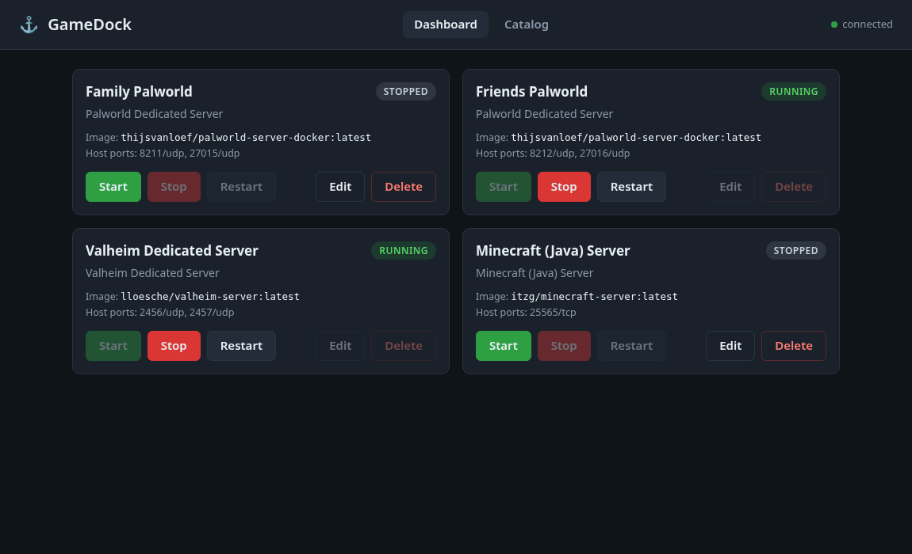

# GameDock

A small, self-hosted game hosting manager for home use. Each game server runs in its own Docker container (SteamCMD and Wine based images work well). GameDock gives you a simple web dashboard to see and control them, and is built so a built-in MCP endpoint for AI agents can be added on top of the same service layer.

GameDock is not tied to any particular machine or game: games are described by small YAML files in `catalog/`.




**Status:** step 3 of the plan. Browse a catalog of game templates, deploy servers (several of the same game can coexist on different ports), edit their settings, start / stop / restart, back up and restore their data, update their images, edit their config files, and delete them safely. Planned next: resource monitoring and the MCP endpoint.

## Concepts

- **Catalog entry**: a game template in `catalog/*.yaml` (image, default ports, volumes, the settings you can fill in).
- **Server**: a deployed instance made from a catalog entry. It has its own name, host ports and settings, and is stored in `data/instances.json` (created with mode 0600 because it can contain passwords; `data/` is git-ignored). A server keeps a snapshot of its template, so later catalog edits never break it.

## Run it

Requires Python 3.10+ and, for real use, Docker (the `docker` command must work for the user running GameDock).

```bash
python3 -m venv .venv
. .venv/bin/activate
pip install -e .            # or: pip install -r requirements.txt
cp .env.example .env        # optional; edit as needed
python -m gamedock          # then open http://127.0.0.1:8080
```

Try it without Docker using the pretend in-memory engine:

```bash
GAMEDOCK_BACKEND=fake python -m gamedock
```

### Settings (environment variables or `.env`)

| Variable | Default | Meaning |
|---|---|---|
| `GAMEDOCK_HOST` | `127.0.0.1` | Listen address. Local only by default. Only set `0.0.0.0` if you accept that anyone who can reach the port can control your servers (no login yet). |
| `GAMEDOCK_PORT` | `8080` | Web port |
| `GAMEDOCK_CATALOG_DIR` | `./catalog` | Folder of game definition files |
| `GAMEDOCK_DATA_DIR` | `./data` | Server data and `instances.json`. Relative volume paths go under `<data>/<server id>/` |
| `GAMEDOCK_BACKEND` | `docker` | `docker` or `fake` |
| `GAMEDOCK_BACKUP_RETENTION` | `10` | Backups kept per server; the oldest are removed after each new backup |

## Using it

1. Open **Catalog**, press **Deploy** on a game.
2. Pick a name, check the host ports (prefilled with the defaults; a port already used by another server is refused) and fill in the settings. Password-type settings use password inputs and are never shown again, logged, or returned by the API.
3. Tick **Start after deploy** if you want it to run right away. Deploy creates the container either way.
4. On the **Dashboard**: Start / Stop / Restart, **Edit** (name, ports, settings; server must be stopped, its container is recreated; leave a password blank to keep the stored one) and **Delete**.

## Backups

Every server has a **Backups** panel (dashboard card, "Backups" button).

- **Create backup** writes `<data>/backups/<server id>/<server id>-YYYYMMDD-HHMMSS.tar.gz` (UTC time in the name) containing the server's data folder (`<data>/<server id>/`). No sudo is used.
- **Consistent by default:** if the server is running, GameDock stops it, takes the backup and starts it again, and tells you so. Tick "Back up without stopping (live)" to skip that; the result then warns the files may be inconsistent.
- **Retention:** only the newest N backups per server are kept (default 10, `GAMEDOCK_BACKUP_RETENTION`), applied after every new backup.
- **Restore** needs a stopped server and confirmation. Before replacing anything GameDock takes an automatic safety backup (`...-pre-restore.tar.gz`); if that fails the restore is cancelled. The archive is checked first (no `..`, absolute paths, or links pointing outside) and unpacked beside the data folder before being swapped in, so a damaged backup never touches your current data.
- **Delete backup** needs confirmation.
- **Wipe data** (empties the data folder, keeps the server) needs confirmation and a stopped server, and takes a `...-pre-wipe` backup first.
- **Delete server with its data** needs two confirmations (`confirm` and `confirm_delete_data`), a stopped server, and first saves a backup outside the data folder at `<data>/backups/_deleted/<id>-<time>-pre-delete.tar.gz`. If that backup fails nothing is deleted.
- **Permissions:** GameDock runs as its own user. If a game container wrote files as another user (often root) that GameDock cannot read, the backup stops with a clear message (and the `chown` command that would fix it), nothing partial is left, and any operation that needed the backup first (restore, wipe, delete with data, update) is cancelled.
- Only the server's own data folder is saved. Volumes with an **absolute** host path in a catalog entry live outside it and are not backed up. Backups are taken and restored as the GameDock user, so file ownership becomes that user's.

## Updating a server

**Update** (dashboard card) pulls the newest version of the server's image and recreates the container, keeping data and settings. GameDock pulls first; if the image is already the newest, nothing else happens. Otherwise it stops the server if running (with a 60 s grace period), takes an automatic `...-pre-update` backup (if that fails the update is cancelled and the server is restarted), recreates the container and starts it again if it had been running. The image id before and after is shown. A catalog entry can set `update_method: none` for games that update themselves inside the container (the Update button then disappears).

## Editing config files

A catalog entry can declare config files; each server then gets a **Config** button with a text editor.

- Only declared files can be opened, and the path must stay inside the server's data folder: `..`, absolute paths, and symlinks (to outside or inside) are refused.
- Files are limited to 256 KB of UTF-8 text. JSON files are validated before saving.
- Every save first copies the old file to `<name>.<timestamp>.bak` beside it (the newest 10 are kept) and then replaces it atomically.
- Saving is refused while the server runs unless the catalog marks the file `hot_edit: true`. Most games need a restart to pick up changes; the editor says so.
- `sensitive_keys` values (passwords) are shown as `********`. Leave the placeholder to keep the real value; type over it to change it. Works for `key=value`, `key: value`, JSON and inline `Key="value"` styles.

## Server data and settings

## Adding a game

Drop a `.yaml` (or `.json`) file in `catalog/`; it appears in the Catalog page without a restart.

```yaml
id: my-game              # lowercase letters, digits, - and _
name: My Game Server
image: some/image:tag
description: One line shown on the card.
notes: Shown in amber on the card (use it for warnings).
ports:                   # defaults; each server can choose its own host ports
  - { protocol: udp, host: 27015, container: 27015 }
volumes:
  - { host: ./saves, container: /saves }   # relative = under <data>/<server id>/
env:                     # fixed values, not editable in the deploy form
  SOME_FLAG: "1"
update_method: pull_recreate   # default; or 'none' if the game updates itself
config_files:            # files users may edit (relative to the server's data folder)
  - path: saves/settings.ini
    label: Settings
    format: ini          # ini | json | yaml | text (json is validated)
    sensitive_keys: [AdminPassword]
    hot_edit: false      # true = safe to edit while running
fields:                  # settings shown in the deploy/edit form
  - { name: SERVER_NAME, label: Server name, default: "My Server", required: true }
  - { name: SERVER_PASSWORD, label: Password, secret: true }   # secret = password input
```

Never put real passwords in catalog files (they are committed to git); users type them into the deploy form.

A server keeps a snapshot of its template from the time it was deployed, so config files and update settings added to a catalog entry later only apply to servers deployed afterwards.

**The bundled entries (Enshrouded, Palworld, Valheim, Minecraft Java, Satisfactory) are examples.** Their images, ports and variables are written from general knowledge of popular community images and have not been tested here. Check each against the image's own documentation before real use.

## API

| Method | Path | |
|---|---|---|
| GET | `/api/catalog`, `/api/catalog/{id}` | game templates |
| GET | `/api/servers`, `/api/servers/{id}` | deployed servers with status |
| POST | `/api/servers` | deploy: `{game_id, name, ports:[{protocol,container,host}], env:{}, start}` |
| PATCH | `/api/servers/{id}` | edit `name`, `ports`, `env` (stopped servers only) |
| POST | `/api/servers/{id}/start` `/stop` `/restart` | lifecycle |
| DELETE | `/api/servers/{id}?confirm=true` | delete (data kept); add `&delete_data=true&confirm_delete_data=true` to delete data too (backup taken first) |
| GET / POST | `/api/servers/{id}/backups` | list (with retention) / create (`{"live": false}`) |
| POST | `/api/servers/{id}/backups/{name}/restore?confirm=true` | restore |
| DELETE | `/api/servers/{id}/backups/{name}?confirm=true` | delete a backup |
| POST | `/api/servers/{id}/wipe-data?confirm=true` | empty the data folder (backup first) |
| GET | `/api/servers/{id}/image` | image name and current image id |
| POST | `/api/servers/{id}/update-image?confirm=true` | update the image |
| GET | `/api/servers/{id}/config` | declared config files |
| GET / PUT | `/api/servers/{id}/config/file?path=...` | read (masked) / save `{path, content}` |
| GET | `/api/health` | liveness |

Errors are `{"error": "..."}` with 400 (invalid or missing confirmation), 403 (file permission problem), 404 (unknown), 409 (conflict: port in use, server running, or another operation in progress), 413 (file too large), 422 (malformed request), 500 (operation failed, e.g. disk full) or 502 (Docker problem). Interactive docs at `/api/docs`.

## Layout

```
gamedock/
  models.py        plain data types (catalog entry vs server instance)
  catalog.py       YAML template loader + validation
  store.py         persistent JSON store of deployed servers
  backups.py       backup archives: create, list, restore, prune
  configfiles.py   safe config file read/write, masking, .bak copies
  service.py       all management logic (web and future MCP call this)
  backends/        container engine interface: docker_cli.py (real), fake.py (in-memory)
  web/             FastAPI app + static dashboard (vanilla JS, no build step)
catalog/           game templates (examples)
tests/             pytest suite (no Docker needed)
```

## Tests

```bash
pip install -e '.[dev]'
pytest
```

## Safety notes

- Binds to `127.0.0.1` unless you configure otherwise.
- Environment values are handed to Docker through the process environment, not on the command line.
- State-changing requests from a different web origin are refused.
- `.env`, `data/` (including `instances.json`, mode 0600) and `backups/` are git-ignored.
- Destructive actions (restore, delete, wipe, update) need an explicit confirmation in both the UI and the API, and take a backup first.
- Only one state-changing operation runs per server at a time.
- Secret settings are never returned by the API, shown in the UI after saving, or included in logs/`repr`.
