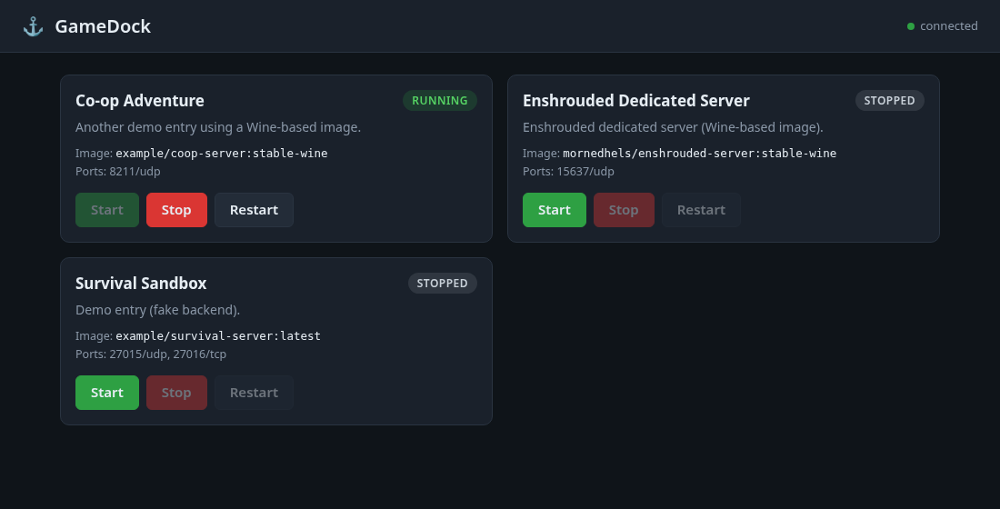

# GameDock

A small, self-hosted game hosting manager for home use. Each game server runs in its own Docker container (SteamCMD and Wine based images work well). GameDock gives you a simple web dashboard to see and control them, and is built so a built-in MCP endpoint for AI agents can be added on top of the same service layer.

GameDock is not tied to any particular machine or game: games are described by small YAML files in `catalog/`.



**Status:** step 1 of the plan. You can list servers, see status, and start / stop / restart them. Planned next: catalog browsing and deploy, config editing, backups and updates, resource monitoring, MCP endpoint.

## Run it

Requires Python 3.10+ and, for real use, Docker (the `docker` command must work for the user running GameDock).

```bash
python3 -m venv .venv
. .venv/bin/activate
pip install -e .            # or: pip install -r requirements.txt
cp .env.example .env        # optional; edit as needed
python -m gamedock          # then open http://127.0.0.1:8080
```

Try it without Docker using the pretend in-memory engine:

```bash
GAMEDOCK_BACKEND=fake python -m gamedock
```

### Settings (environment variables or `.env`)

| Variable | Default | Meaning |
|---|---|---|
| `GAMEDOCK_HOST` | `127.0.0.1` | Listen address. Local only by default. Only set `0.0.0.0` if you accept that anyone who can reach the port can control your servers (no login yet). |
| `GAMEDOCK_PORT` | `8080` | Web port |
| `GAMEDOCK_CATALOG_DIR` | `./catalog` | Folder of game definition files |
| `GAMEDOCK_DATA_DIR` | `./data` | Server data. Relative volume paths go under `<data>/<game id>/` |
| `GAMEDOCK_BACKEND` | `docker` | `docker` or `fake` |

## Adding a game

Drop a `.yaml` (or `.json`) file in `catalog/`. See `catalog/enshrouded.yaml` for an example:

```yaml
id: my-game              # lowercase letters, digits, - and _
name: My Game Server
image: some/image:tag
ports:
  - { protocol: udp, host: 27015, container: 27015 }
volumes:
  - { host: ./saves, container: /saves }   # relative = under <data>/<id>/
env:
  SERVER_NAME: "My Server"
```

Definitions are re-read on every request, so no restart is needed. Don't put passwords in catalog files (they are committed to git); secret handling comes in a later step. Containers are named `gamedock-<id>`; the first Start creates the container, later ones reuse it.

## API

| Method | Path | |
|---|---|---|
| GET | `/api/servers` | list all servers with status |
| GET | `/api/servers/{id}` | one server |
| POST | `/api/servers/{id}/start` | create if needed, then start |
| POST | `/api/servers/{id}/stop` | stop (60 s grace for saving) |
| POST | `/api/servers/{id}/restart` | stop then start |
| GET | `/api/health` | liveness |

Interactive docs at `/api/docs`.

## Layout

```
gamedock/
  models.py        plain data types
  catalog.py       YAML definition loader + validation
  service.py       all management logic (web and future MCP call this)
  backends/        container engine interface: docker_cli.py (real), fake.py (in-memory)
  web/             FastAPI app + static dashboard (vanilla JS, no build step)
catalog/           game definitions
tests/             pytest suite (no Docker needed)
```

## Tests

```bash
pip install -e '.[dev]'
pytest
```

## Safety notes

- Binds to `127.0.0.1` unless you configure otherwise.
- Environment values are handed to Docker through the process environment, not on the command line.
- State-changing requests from a different web origin are refused.
- `.env`, `data/` and `backups/` are git-ignored.
