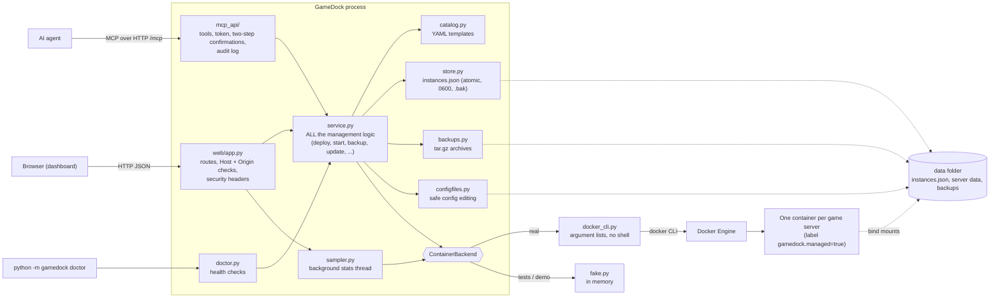

# How GameDock is built

GameDock is one Python program (FastAPI + uvicorn). There is no database, no build step for the page, and no extra process for the AI endpoint.

## The three layers

1. **Web layer** (`gamedock/web/`, `gamedock/mcp_api/`). Turns requests into service calls and results into JSON. It decides nothing about games or containers. Security checks that belong to HTTP (Host name, Origin, token) live here.
2. **Service layer** (`gamedock/service.py`). The only place that knows how to deploy, start, stop, back up, restore, update or delete. The web page and the MCP tools call the same functions, so they cannot disagree. It takes locks (one change per server at a time, one deploy at a time) and always takes a backup before anything destructive.
3. **Backend** (`gamedock/backends/`). A small interface (`ContainerBackend`) with two implementations: `DockerCliBackend` runs the `docker` command, `FakeBackend` keeps everything in memory for tests and demos. Swapping them needs no change anywhere else.

## Rules the code follows

- **Never a shell.** Every docker call is an argument list. Values from catalog files or forms are never pasted into a command string.
- **Only our own containers.** Containers are created with the label `gamedock.managed=true`. Before touching a container by name GameDock checks the label; a container without it is reported and left alone.
- **Secrets stay out of sight.** Environment values reach Docker through the child process environment. They are stored only in `instances.json` (0600) and removed from API output, MCP output, logs and the audit file.
- **Files on disk are written safely.** The server list and config files are written to a temporary file, flushed to disk and renamed over the old one; the previous server list is kept as `instances.json.bak`. Backups are private (0600 in a 0700 folder).
- **A server keeps a copy of its template.** Editing a catalog file later cannot break servers that already exist.
- **Friendly failures.** Docker errors are translated into a plain sentence plus the fix (daemon down, no permission, port in use, disk full, image not found, wrong CPU type, name taken). The doctor reuses the same text.

## Where things are stored

| What | Where |
|---|---|
| Deployed servers | `<data>/instances.json` (+ `.bak`) |
| A server's game files | `<data>/<server id>/...` (bind-mounted into its container) |
| Backups | `<data>/backups/<server id>/*.tar.gz`, deleted servers in `<data>/backups/_deleted/` |
| MCP audit log | `<data>/mcp-audit.jsonl` |
| Live stats history | memory only (gone on restart) |

## A request, step by step: "Start" on the dashboard

1. The page sends `POST /api/servers/<id>/start`.
2. The web layer checks the Host name and Origin, then calls `service.start(id)`.
3. The service takes that server's lock, refuses if another change is in progress, checks that the host ports are free (it tries to bind them), and asks the backend to start.
4. `DockerCliBackend` checks the container exists and carries our label, then runs `docker start gamedock-<id>`.
5. The result (or a friendly error) goes back up and the page redraws the card.

## Testing

`tests/` runs without Docker. The engine is the in-memory fake; the Docker command is checked by recording the exact argument lists it would run, and by tiny fake `docker` shell scripts that simulate "daemon down" and "permission denied". The real engine is exercised for the first time in [NIMO_FIRST_TEST.md](NIMO_FIRST_TEST.md).
