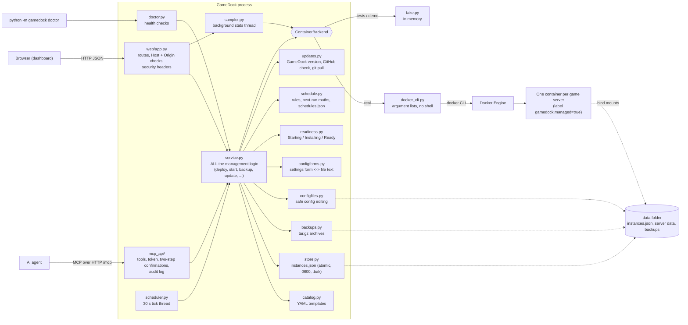

# How GameDock is built

GameDock is one Python program (FastAPI + uvicorn). There is no database, no build step for the page, and no extra process for the AI endpoint.

## The three layers

1. **Web layer** (`gamedock/web/`, `gamedock/mcp_api/`). Turns requests into service calls and results into JSON. It decides nothing about games or containers. Security checks that belong to HTTP (Host name, Origin, token) live here.
2. **Service layer** (`gamedock/service.py`). The only place that knows how to deploy, start, stop, back up, restore, update or delete. The web page and the MCP tools call the same functions, so they cannot disagree. It takes locks (one change per server at a time, one deploy at a time) and always takes a backup before anything destructive.
3. **Backend** (`gamedock/backends/`). A small interface (`ContainerBackend`) with two implementations: `DockerCliBackend` runs the `docker` command, `FakeBackend` keeps everything in memory for tests and demos. Swapping them needs no change anywhere else.

## Rules the code follows

- **Never a shell.** Every docker call is an argument list. Values from catalog files or forms are never pasted into a command string.
- **Only our own containers.** Containers are created with the label `gamedock.managed=true`. Before touching a container by name GameDock checks the label; a container without it is reported and left alone.
- **Secrets stay out of sight.** Environment values reach Docker through the child process environment. They are stored only in `instances.json` (0600) and removed from API output, MCP output, logs and the audit file.
- **Files on disk are written safely.** The server list and config files are written to a temporary file, flushed to disk and renamed over the old one; the previous server list is kept as `instances.json.bak`. Backups are private (0600 in a 0700 folder).
- **A server keeps a copy of its template.** Editing a catalog file later cannot break servers that already exist.
- **Friendly failures.** Docker errors are translated into a plain sentence plus the fix (daemon down, no permission, port in use, disk full, image not found, wrong CPU type, name taken). The doctor reuses the same text.

## Readiness, activity and logs

- **`readiness.py`** is pure logic: `decide(health, has_ready_pattern, ready_seen, progress)` returns a phase (`starting`, `installing`, `ready`, `unhealthy`), an optional percentage and a plain sentence. Docker's `State.Health.Status` comes from the backend; the log is only read when it is needed (never for a healthy container), at most every `READINESS_TTL` (2 s) per server, always limited to lines since the container's `StartedAt` so output of an earlier run cannot count. A found ready line is remembered per container start. A download percentage only counts if it is in the most recent log lines.
- **Activity.** `service._operation` records what GameDock is doing to a server (deploying, stopping, backing up, ...) while it holds the server's lock. `list_servers` and `get_status` include it, plus a placeholder entry for a deploy that has not created its container yet, so the page, a reload and MCP clients all see the same thing. Action responses do not include it.
- **Logs.** `ContainerBackend.get_logs(name, tail, since)` is implemented by `docker logs` (argument list, `since` validated, tail capped) and by the fake backend. The service cleans the text (ANSI, carriage-return progress lines), masks the server's secret values and reports whether it was cut.
- **`configforms.py`** scans a config file into fields with character spans and rewrites only the spans of changed values, so untouched text is preserved exactly. It never writes anything: the web page asks the read-only `config/form` endpoint for the new text and saves it through `write_config_file`, which keeps all the safety rules (masking, `.bak`, path checks, `hot_edit`) in one place.

## Schedules and updates

- **`schedule.py`** holds the pure maths and the store. `next_run(rule, since, tz)` works in the machine's timezone with real wall-clock times: a time skipped by daylight saving runs just after the gap, a repeated hour runs once. `ScheduleStore` keeps `schedules.json` in memory, writes it atomically (0600) and validates strictly on read and write; a damaged file is set aside as `.broken-<time>` and reported, an invalid per-server entry is ignored and reported.
- **`scheduler.py`** is a daemon thread that wakes every 30 s (first run after 5 s) and calls `service.process_schedules(now, spawn)`, which finds due jobs, runs each in its own thread and also refreshes due image checks. Jobs go through the same `_operation` lock as any click, so a busy server raises `BusyError` and the job is recorded as skipped. A backup that was missed (GameDock was off) runs once; a maintenance more than 6 hours late is skipped. `process_schedules` takes `spawn` and `now` so tests run it synchronously.
- **Maintenance** (`_job_maintenance`) is a sequence over the existing building blocks (`_backup_locked`, `_update_image_locked`, restart), all under one lock acquisition, so nothing can interleave. The first failing step stops the run and is recorded with a plain message. Results go to the server's history (30 entries), the run state and the audit log (`audit_hook`).
- **Image updates.** `check_image_update` asks the backend for the registry digest (`remote_image_digest`: `buildx imagetools inspect`, then `manifest inspect`) and compares it with the digests of the image the container runs (`local_image_digests`). Results are cached in memory (`update_available` on the server info).
- **`updates.py`** (`UpdateChecker`) reads local git facts, asks `api.github.com` (only that host, short timeouts, an `http_get` function that tests replace) and applies updates: `git pull --ff-only` after refusing on a dirty tree, detached HEAD, non-fast-forward, changed dependencies or busy work; the service `freeze()`s new actions first and `unfreeze()`s after a failure. The restart is `systemctl [--user] restart --no-block`, else exit code 75, else `os.execv`.

## Where things are stored

| What | Where |
|---|---|
| Deployed servers | `<data>/instances.json` (+ `.bak`) |
| A server's game files | `<data>/<server id>/...` (bind-mounted into its container) |
| Backups | `<data>/backups/<server id>/*.tar.gz`, deleted servers in `<data>/backups/_deleted/` |
| Schedules, run states and run history | `<data>/schedules.json` (atomic, 0600) |
| MCP audit log (also scheduled runs) | `<data>/mcp-audit.jsonl` |
| Update check results (GameDock and images) | memory only |
| Live stats history | memory only (gone on restart) |

## A request, step by step: "Start" on the dashboard

1. The page sends `POST /api/servers/<id>/start`.
2. The web layer checks the Host name and Origin, then calls `service.start(id)`.
3. The service takes that server's lock, refuses if another change is in progress, checks that the host ports are free (it tries to bind them), and asks the backend to start.
4. `DockerCliBackend` checks the container exists and carries our label, then runs `docker start gamedock-<id>`.
5. The result (or a friendly error) goes back up and the page redraws the card.

## Testing

`scripts/make_screenshots.py` starts the real app on the fake backend and drives it with a headless browser (Playwright, not part of the normal test run); it doubles as a browser smoke test for the progress UI, log viewer and config form.

`tests/` runs without Docker. The engine is the in-memory fake; the Docker command is checked by recording the exact argument lists it would run, and by tiny fake `docker` shell scripts that simulate "daemon down" and "permission denied". The real engine is exercised for the first time in [NIMO_FIRST_TEST.md](NIMO_FIRST_TEST.md).
