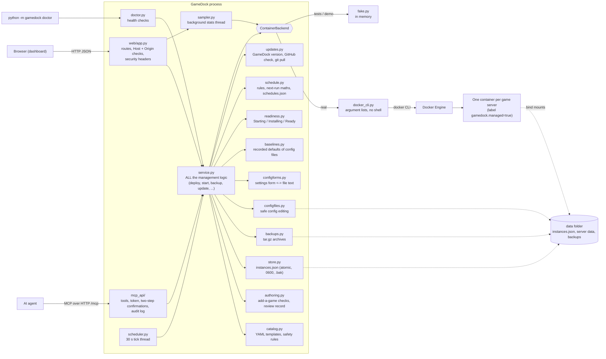

# How GameDock is built

GameDock is one Python program (FastAPI + uvicorn). There is no database, no build step for the page, and no extra process for the AI endpoint.

## The three layers

1. **Web layer** (`gamedock/web/`, `gamedock/mcp_api/`). Turns requests into service calls and results into JSON. It decides nothing about games or containers. Security checks that belong to HTTP (Host name, Origin, token) live here.
2. **Service layer** (`gamedock/service.py`). The only place that knows how to deploy, start, stop, back up, restore, update or delete. The web page and the MCP tools call the same functions, so they cannot disagree. It takes locks (one change per server at a time, one deploy at a time) and always takes a backup before anything destructive.
3. **Backend** (`gamedock/backends/`). A small interface (`ContainerBackend`) with two implementations: `DockerCliBackend` runs the `docker` command, `FakeBackend` keeps everything in memory for tests and demos. Swapping them needs no change anywhere else.

## Rules the code follows

- **Never a shell.** Every docker call is an argument list. Values from catalog files or forms are never pasted into a command string.
- **Only our own containers.** Containers are created with the label `gamedock.managed=true`. Before touching a container by name GameDock checks the label; a container without it is reported and left alone.
- **Secrets stay out of sight.** Environment values reach Docker through the child process environment. They are stored only in `instances.json` (0600) and removed from API output, MCP output, logs and the audit file.
- **Files on disk are written safely.** The server list and config files are written to a temporary file, flushed to disk and renamed over the old one; the previous server list is kept as `instances.json.bak`. Backups are private (0600 in a 0700 folder).
- **A server keeps a copy of its template.** Editing a catalog file later cannot break servers that already exist.
- **Friendly failures.** Docker errors are translated into a plain sentence plus the fix (daemon down, no permission, port in use, disk full, image not found, wrong CPU type, name taken). The doctor reuses the same text.

## Readiness, activity and logs

- **`problems.py` and `problem_service.py` (0.6.1)** explain *why* a server is not ready. `problems.py` is pure: `scan(sources, catalog_patterns, use_builtin, secrets)` tries the entry's `fail_log_patterns` first, then `BUILTIN_PATTERNS`, takes the newest matching line (truncated to 1000 characters before matching), redacts it with `checks.redact_text` and returns a `Problem` (id, title, advice, source, where, excerpt); `docker_problem(exit_code, oom)` covers a container Docker killed for memory. `problem_service.py` (a mixin of the service) supplies the text: the container log read by `_readiness` is reused (no second `docker logs`), declared `log_files` are read as the last 64 KiB through a path confined to the server's data folder (resolved, no symlinks, regular files only, ignored when older than the container start minus 15 s). It runs only while a server runs and is not ready, and results are cached 6 s. `fail_log_patterns`, `log_files`, `builtin_fail_patterns` and field `pattern` / `pattern_hint` are taken from the current catalog entry for existing servers (`_with_current_problem_hints`, `_with_current_field_rules`), because they change no container. The problem reaches the card (`ServerInfo.problem`, replacing the generic unhealthy sentence), Check setup, diagnostics and the MCP tools without a new tool.
- **`readiness.py`** is pure logic: `decide(health, has_ready_pattern, ready_seen, progress)` returns a phase (`starting`, `installing`, `ready`, `unhealthy`), an optional percentage and a plain sentence. Docker's `State.Health.Status` comes from the backend; the log is only read when it is needed (never for a healthy container), at most every `READINESS_TTL` (2 s) per server, always limited to lines since the container's `StartedAt` so output of an earlier run cannot count. A found ready line is remembered per container start. A download percentage only counts if it is in the most recent log lines.
- **Activity.** `service._operation` records what GameDock is doing to a server (deploying, stopping, backing up, ...) while it holds the server's lock. `list_servers` and `get_status` include it, plus a placeholder entry for a deploy that has not created its container yet, so the page, a reload and MCP clients all see the same thing. Action responses do not include it.
- **Logs.** `ContainerBackend.get_logs(name, tail, since)` is implemented by `docker logs` (argument list, `since` validated, tail capped) and by the fake backend. The service cleans the text (ANSI, carriage-return progress lines), masks the server's secret values and reports whether it was cut.
- **`configforms.py`** scans a config file into fields with character spans and rewrites only the spans of changed values, so untouched text is preserved exactly. It never writes anything: the web page asks the read-only `config/form` endpoint for the new text and saves it through `write_config_file`, which keeps all the safety rules (masking, `.bak`, path checks, `hot_edit`) in one place.

- **`baselines.py`** (0.5.2) keeps the *recorded defaults* of a config file so the form can show what differs from them after saving and reopening. The service records a baseline (the parsed `id/key/type/value` list plus a set / not set marker for `sensitive_keys`, never the file text and never a secret) the first time it reads a file that exists and has a form: when a freshly deployed server becomes ready (`_capture_deploy_baselines`, only for servers created in the last 6 hours), otherwise on the first form read, `config/form` call or save (`_capture_baseline`; it never records the unsaved text of a preview, only the file on disk). `create_if_absent` never overwrites; only `record_config_baseline` replaces one (keeping `<sha1>.prev.json`). `compare()` annotates the form fields (`default`, `differs`, `status`) and lists `missing` settings; values are compared by `canon()` (numbers by decimal value, booleans case-insensitively, JSON structurally). The MCP tool `get_config_changes` is a read-only view of the same comparison. `app.js` repeats the same canonical comparison in JavaScript only to keep the markers live while typing; after Save the server's answer is used.

## Schedules and updates

- **`schedule.py`** holds the pure maths and the store. `next_run(rule, since, tz)` works in the machine's timezone with real wall-clock times: a time skipped by daylight saving runs just after the gap, a repeated hour runs once. `ScheduleStore` keeps `schedules.json` in memory, writes it atomically (0600) and validates strictly on read and write; a damaged file is set aside as `.broken-<time>` and reported, an invalid per-server entry is ignored and reported.
- **`scheduler.py`** is a daemon thread that wakes every 30 s (first run after 5 s) and calls `service.process_schedules(now, spawn)`, which finds due jobs, runs each in its own thread and also refreshes due image checks. Jobs go through the same `_operation` lock as any click, so a busy server raises `BusyError` and the job is recorded as skipped. A backup that was missed (GameDock was off) runs once; a maintenance more than 6 hours late is skipped. `process_schedules` takes `spawn` and `now` so tests run it synchronously.
- **Maintenance** (`_job_maintenance`) is a sequence over the existing building blocks (`_backup_locked`, `_update_image_locked`, restart), all under one lock acquisition, so nothing can interleave. The first failing step stops the run and is recorded with a plain message. Results go to the server's history (30 entries), the run state and the audit log (`audit_hook`).
- **Image updates.** `check_image_update` asks the backend for the registry digest (`remote_image_digest`: `buildx imagetools inspect`, then `manifest inspect`) and compares it with the digests of the image the container runs (`local_image_digests`). Results are cached in memory (`update_available` on the server info).
- **Game versions (0.4.0).** `steam.py` is I/O-light and pure where it can be: `parse_manifest` (Valve KeyValues text), `find_manifest` (bounded search of a server's volumes, or the catalog's `steam_manifest_dir`), `SteamInfo` (newest public build per `(app id, branch)` from `GAMEDOCK_STEAM_INFO_URL`, cached an hour in memory and in `<data>/steam-latest.json`, failures cached ten minutes, never raises) and `compute_status`. `game_updates.py` is a mixin of the service: `_game_report` builds the per-server report from the manifest (read each time, it is small), the cached newest build and the game's version text (`version_log_pattern` applied to the log, stored with the build id it was seen on in `<data>/game-versions.json`). The dashboard path never touches the network; the scheduler tick refreshes one stale game per tick (`check_game_updates_due`) and the **Check now** button forces a lookup. `update_game` runs under the server's `_operation` lock: stop, safety backup, start, then `_wait_for_game_build` polls the manifest until the build changes (changed), the game reports ready on the old build (unchanged), the container stops (stopped) or the wait runs out (timeout); the result states which. Maintenance with *apply updates* uses the same pieces and records the before and after build ids in the run message. The fake backend can pretend a self-updating game (`simulate_steam_game`) so all of this is tested and screenshotted without Docker.
- **`updates.py`** (`UpdateChecker`) reads local git facts, asks `api.github.com` (only that host, short timeouts, an `http_get` function that tests replace) and applies updates: `git pull --ff-only` after refusing on a dirty tree, detached HEAD, non-fast-forward, changed dependencies or busy work; the service `freeze()`s new actions first and `unfreeze()`s after a failure. Since 0.6.1, before the pull it moves untracked, same-named plain files directly in `catalog/` that the update adds to `<data>/catalog-displaced/` (restored if the pull fails; never symlinks, tracked files or other paths). The restart is `systemctl [--user] restart --no-block`, else exit code 75, else `os.execv`.

## Adding games, and the review step

- **One schema.** `catalog.py` holds the list of keys an entry may have (`ENTRY_KEYS` and the keys of ports, volumes, fields and config files) and `safety_problems()`. `authoring.py` holds `FIELD_REFERENCE`, one row per key. A test checks that the two name exactly the same keys and that the table inside `docs/ADDING_A_GAME.md` equals the generated one (`scripts/update_docs.py` rewrites it), so the documentation cannot drift from the code.
- **Two origins.** An entry has `origin` `repo` (a file a person put in `catalog/`, trusted) or `mcp` (written by `add_catalog_entry`). The loader learns which from `<data>/catalog-review.json` (`added_by_ai` argument): ids listed there are parsed with the strict rules (known keys only, relative host folders, host ports 1024 or higher). The dangerous things (privileged, host network, devices, capabilities, Docker socket) are refused for both origins. Files starting with `_` or `.` are not loaded.
- **Review record.** `catalog-review.json` maps entry id to `{added_by, added_at, reviewed, yaml_sha256, file, reviewed_sha256, reviewed_at}`. An entry is `reviewed` only if the record says so **and** `reviewed_sha256` equals the SHA-256 of the file as loaded now, so any later edit by anyone makes it unreviewed again. Approve and reject are web routes only. `add_catalog_entry` writes the record first and the file second (a file without a record would look like a trusted repository entry), the file atomically (temporary file, then a hard link so an existing file can never be replaced), only at `<catalog dir>/<id>.yaml` after the id matched the id pattern. `update_catalog_entry` and reject refuse files that git tracks.
- **The gate.** `GameDockService._deploy` calls `require_reviewed`, so the web API, the dashboard, MCP `deploy_server` and anything else that deploys are all stopped at one place.
- **`inspect_image`.** A backend method (`ContainerBackend.inspect_image`) that runs only `docker image inspect`, `docker buildx imagetools inspect` and `docker manifest inspect`; parsing is in `backends/image_inspect.py` (bounded lists, environment variable names only). It never pulls or runs; a test checks every command it issues.

## Checks, diagnostics and port conflicts (0.6.0)

All read-only; the web page and the MCP tools call the same service methods.

- **`ops_service.py`** (`OpsMixin` of the service): `verify_game_setup` builds a list of `checks.Check` (id, title, pass / warn / fail / skip, detail, fix) from the backend's `get_state` and `container_details`, the Steam manifests in the server's volumes (`steam.list_manifests` finds *all* records, so a wrong `steam_app_id` can be named), the config files (read with the same safe-path rules as the editor), Docker's published ports, the volumes' state and the snapshot-versus-current catalog comparison (`template_drift`). `get_server_diagnostics` assembles the bundle and `diagnostics_text` renders it; log lines go through `checks.redact_text` (known secret values, `password=` / `token=` shapes, bearer tokens, URL credentials). `preview_deploy` builds the same `docker create` argument list as a real deploy (`DockerCliBackend.build_create_args`, secrets masked) and creates nothing.
- **`portcheck.py`** is pure: `find_conflicts(wanted, servers, catalog_defaults, probe)` returns findings (kind `gamedock_server`, `host_listener`, `catalog_default`, `duplicate`, `invalid`; level conflict / warn / info) and `suggest_free`. The probe is `hostcheck.port_free` and is only wired for the real Docker backend (tests inject it; `None` means "not checked", and the answer says so). Port facts from Docker come from `container_details`, which parses `docker container inspect` (`backends/container_inspect.py`; the environment is never read, and only containers with the `gamedock.managed` label are described).
- **Authoring additions.** `InspectionStore` (`<data>/inspected-images.json`, 0600, 100 entries, environment variable names only, never values) remembers what `inspect_image` saw for each exact tag, so `validate_catalog_entry` can warn about a tag that was never inspected, one that does not exist, and image ports, variables and folders the entry ignores. `inspect_image` asks Docker Hub's public tag list (read-only, only when update checks are enabled and only for Docker Hub images) to say which tags exist. `CatalogAuthoring.review_status` reports `waiting_for_approval`, `approved`, `changed_since_approval` or `repository` from the review record and the file's fingerprint. Nothing here approves or records anything.
- **`lint.py`** and `scripts/lint_catalog.py` load every catalog file the way the program does and add the Review dialog's checks; a test fails when a catalog file has an error.
- **MCP.** Six new read-only tools (`get_catalog_review_status`, `verify_game_setup`, `check_ports`, `preview_deploy`, `get_server_diagnostics`, `get_mcp_audit`; read_only 24, standard 37, full 41 tools). The audit tool reuses `AuditLog.recent`, which masks arguments a second time on the way out.

## File owners and running as GameDock's user (0.6.2)

- **Backend.** `repair_ownership(host_dir, uid, gid)` is part of the backend interface. `DockerCliBackend` builds the helper with `build_chown_args` (`docker run --rm --network none --read-only --user 0:0 --cap-drop ALL --cap-add CHOWN,DAC_OVERRIDE,DAC_READ_SEARCH,FOWNER --security-opt no-new-privileges --mount type=bind,source=<dir>,target=/d --entrypoint chown -- <image> -R -h uid:gid /d`) and picks the image in `_helper_image` (configured image if stored, else a stored `alpine`/`busybox`, else pull the configured one). `FakeBackend` records the call and gives the owner back full access to every file (what a chown achieves for root-owned 600/700 files), or raises `ownership_fail`.
- **Service.** `_ownership_target` allows exactly `<data dir>/<server id>` (plain id, not reserved, not a symlink, realpath's parent is the realpath of the data folder). `_with_repair(inst, fn)` runs `fn`, and on `AccessError` repairs and retries once; `_proactive_repair` repairs before data is backed up, replaced or deleted when `hostcheck.foreign_owners` finds files of another user (it never raises). Used by `_safety_backup`, `_backup_locked`, `restore_backup`, `wipe_data`, `delete` (before the pre-delete backup and again after the container is removed) and the config read/write paths. `fix_data_ownership` is the explicit, non-destructive version for the web button and the MCP tool. A repair adds one sentence to the action's note.
- **Catalog.** `user_env` (name -> `uid`/`gid`) and `run_as_user` are parsed in `catalog._parse_user`; `GameDockService.user_env_values` and `run_as_value` turn them into env values and `ContainerSpec.user` (`docker create --user`, numeric only) in `_spec` and `preview_deploy`. `authoring.user_id_env_names` drives the lint warnings (fixed ids in env/fields, unmapped id variables of an inspected image).
- **MCP.** `fix_data_ownership` (standard tier, idempotent, not destructive; audited). Tool counts: read_only 24, standard 38, full 42.
- **Check.** `OpsMixin._check_ownership` adds the File ownership row; `checks.Check.action = "fix_ownership"` tells the web page to show the button.

## Where things are stored

| What | Where |
|---|---|
| Deployed servers | `<data>/instances.json` (+ `.bak`) |
| A server's game files | `<data>/<server id>/...` (bind-mounted into its container) |
| Backups | `<data>/backups/<server id>/*.tar.gz`, deleted servers in `<data>/backups/_deleted/` |
| Recorded defaults of config files (0.5.2) | `<data>/config-baselines/<server id>/<sha1 of path>.json` (+ `.prev.json`; 0600 in a 0700 folder, outside the game's folders; removed with the data) |
| Schedules, run states and run history | `<data>/schedules.json` (atomic, 0600) |
| MCP audit log (also scheduled runs, approvals in the web page) | `<data>/mcp-audit.jsonl` |
| Which catalog entries an AI added, and whether you approved them | `<data>/catalog-review.json` (atomic, 0600; not in the repository) |
| What `inspect_image` saw for each exact tag (env variable names only) | `<data>/inspected-images.json` (atomic, 0600) |
| Newest Steam build per game (cache, 1 hour) | `<data>/steam-latest.json` |
| The game's own version text, with the build it belongs to | `<data>/game-versions.json` |
| Update check results (GameDock, images) | memory only |
| Live stats history | memory only (gone on restart) |

## A request, step by step: "Start" on the dashboard

1. The page sends `POST /api/servers/<id>/start`.
2. The web layer checks the Host name and Origin, then calls `service.start(id)`.
3. The service takes that server's lock, refuses if another change is in progress, checks that the host ports are free (it tries to bind them), and asks the backend to start.
4. `DockerCliBackend` checks the container exists and carries our label, then runs `docker start gamedock-<id>`.
5. The result (or a friendly error) goes back up and the page redraws the card.

## Testing

## Setting rules (0.6.3)

- **`settings_schema.py`** is pure: `SettingSpec` / `Choice`, `parse_schema` (catalog errors for malformed rules, including YAML booleans among word choices), `check_value`, `find_spec` (JSON dotted path, ini key or `[Section]key`) and `find_by_name` (the name a game prints in its error). `SettingsInvalid` is a `ValidationError` carrying `problems`.
- **Catalog.** `ConfigFile.schema` / `schema_none` and `EnvField.rules`. `service._config_file` / `config_schema` replace a server's snapshot schema with the current catalog entry's (as with problem hints), so rules reach deployed servers without a redeploy.
- **Checks.** `configforms.validate_text` checks a whole file (masked values skipped), `annotate` marks form fields (`setting`, `invalid`). `write_config_file` raises `SettingsInvalid` unless `force` (web only; logged); `update_config_settings` edits single settings via `apply_changes`; `_merge_env` checks field rules on deploy/update. The web app maps `SettingsInvalid` to 400 `{error, invalid_settings}`; MCP to a ToolError with that JSON (audit status `refused`).
- **Failed to start.** `problems.py` has built-in `config-invalid` and `process-gave-up` patterns (`FATAL_IDS`); `config_error_detail` extracts setting, value and allowed values; `problem_service._locate_setting` maps them to `config_path`/`setting_path`. `_info` turns a fatal problem on a running, not ready server into `readiness.PHASE_FAILED`. `ops_service._check_setting_values` adds the "Settings valid" row.
- **MCP.** `get_setting_options` (read) and `update_config_settings` (standard): read_only 25, standard 40, full 44 tools.

`scripts/make_screenshots.py` (and `make_screenshots_authoring.py` for the review step) start the real app on the fake backend and drives it with a headless browser (Playwright, not part of the normal test run); it doubles as a browser smoke test for the progress UI, log viewer and config form. `make_screenshots_defaults.py` shows the 0.5.2 "Not default" markers and `make_screenshots_checks.py` the 0.6.0 Check setup dialog, the port-conflict note and the diagnostics. `scripts/lint_catalog.py` lints the catalog (the tests run it).

`scripts/check_dialog_layout.py` is the layout check for dialogs: every dialog is built by `openDialog()` as title, one scrolling body and a footer (CSS classes `.dlg`, `.dialog-body`, `.dialog-foot`), and the check asserts a fixed size, visible buttons and a single scroll area at 1000x880, 700x500 and 390x760 (it also runs under pytest, skipped without Playwright and Chrome).

`tests/` runs without Docker. The engine is the in-memory fake; the Docker command is checked by recording the exact argument lists it would run, and by tiny fake `docker` shell scripts that simulate "daemon down" and "permission denied". The real engine is exercised for the first time in [NIMO_FIRST_TEST.md](NIMO_FIRST_TEST.md).
